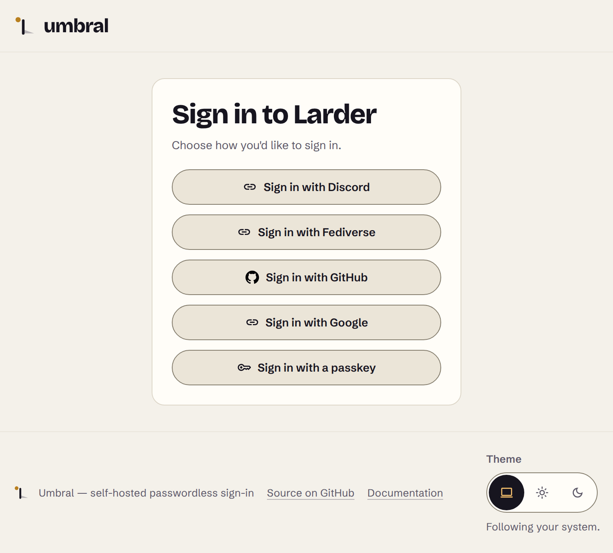
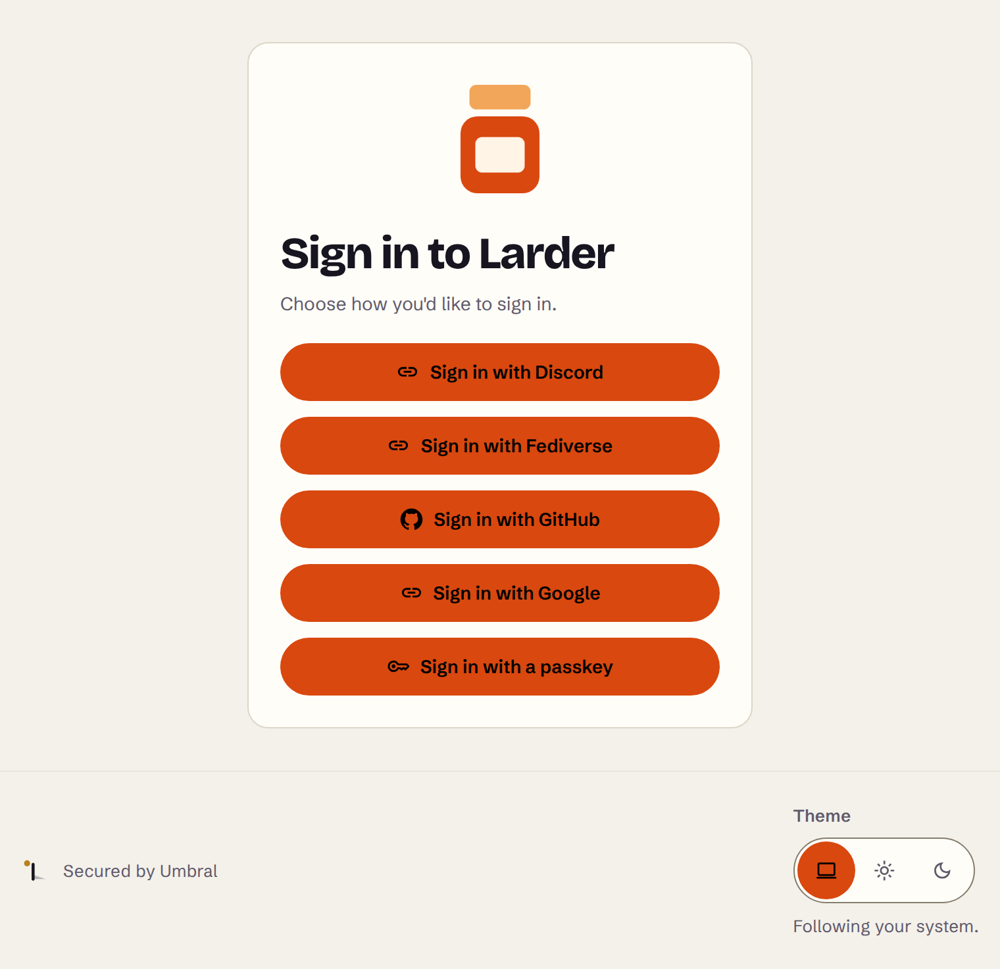

# How it looks

Umbral has one look, called Umbra: a warm gold accent on near-black, or on
paper in the light theme, with the **Gnomon** as its mark (a sundial's upright
and its shadow).

<picture>
  <source media="(prefers-color-scheme: dark)" srcset="images/sign-in-dark.png">
  
</picture>

The operator screens have a side rail with the three screens, **Apps**,
**Connectors** and **Users**, the **Credential** page, and **Sign out**; on a
narrow screen it stacks above the page.

**Two themes, and it follows your system.** By default Umbral is dark or light
as your operating system or browser says, and changes when it does. To pick one
yourself use the **Theme** control: *Follow system*, *Light* or *Dark*. It is at
the bottom of the side rail on the operator screens and in the footer of every
other page, the sign-in page people see included (also on an app's branded
page). It is a plain form, so it works with JavaScript off.

**An app can show its own logo and colour.** Its sign-in page then carries them in
place of Umbral's gold and name bar; see [Brand an app's sign-in page](branding.md).

<picture>
  <source media="(prefers-color-scheme: dark)" srcset="images/sign-in-branded-dark.png">
  
</picture>

**The choice is one cookie, in that browser.** `umbral_theme` holds `light` or
`dark` for a year; *Follow system* removes it. Nothing about it is stored on the
server, and it is not tied to a person or an account, so each browser chooses for
itself.

**The sign-in page remembers the way in, not the person.** After someone signs in,
their browser keeps the connector they used in a second cookie,
`umbral_last_connector`, for a year: only its name as in the URL (`google`,
`discord`, `passkey`), never an email, a name or an account. The next time, when
the page offers that connector among others, its button comes first with a
**Last used** badge, then "or", then the rest; otherwise the page is as usual. It
is written only by a sign-in that worked (never by a failed or refused one, nor by
your own sign-in to the admin screens), and signing out leaves it, because it
describes the browser rather than a session. The page is seen before anyone is
signed in, which is why it holds nothing that says who signed in.

**The fonts are served by Umbral itself.** Bricolage Grotesque (headings),
Schibsted Grotesk (text) and Spline Sans Mono (identifiers and secrets) are
shipped inside the image, as a Latin subset of about 84 KB in all, and loaded
from Umbral's own address. No page asks Google or anyone else for a font, so no
third party learns that someone opened your sign-in page. All three are under the
SIL Open Font License; the licence files are in `src/Umbral/Assets/fonts/` and,
in the image, in `/app/licenses/fonts/`.
