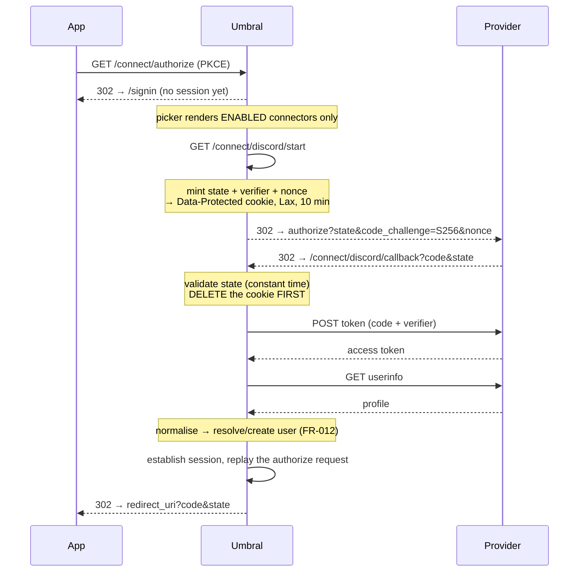

# Contract: social connectors

**Feature**: `001-umbral-mvp`

Umbral as an OAuth 2.0 *client* of Discord, GitHub and Google. Hand-rolled per
D1, behind one seam so that all three providers share every line of security-
relevant code.

## The seam

```fsharp
/// What every provider is normalised to. The only thing downstream code sees.
type ProviderProfile =
    { Subject      : string          // the provider's IMMUTABLE id
      Email        : string option
      EmailVerified: bool
      DisplayName  : string option
      AvatarUrl    : string option } // fully composed, never a raw hash

type ConnectorError =
    | ProviderDeclined of reason: string   // user hit "cancel"
    | ProviderRejected of error: string    // bad credentials, revoked app
    | ProviderUnreachable
    | MalformedResponse of detail: string

type IProviderAdapter =
    abstract Kind: ProviderKind
    /// Pure. Everything needed to build the URL is an argument.
    abstract BuildAuthorizeUrl:
        Connector * redirectUri: Uri * state: string * codeChallenge: string * nonce: string -> Uri
    /// The only method that touches the network.
    abstract ExchangeAndFetch:
        Connector * redirectUri: Uri * code: string * codeVerifier: string * nonce: string
            -> Task<Result<ProviderProfile, ConnectorError>>
```

Three implementations in `Infrastructure/ProviderAdapters.fs`, each taking an
`HttpClient` from `IHttpClientFactory`. `BuildAuthorizeUrl` being pure is what
makes the golden URL tests possible.

## Routes

```
GET /connect/{slug}/start      → 302 to the provider
GET /connect/{slug}/callback   ← the provider returns here
```

**One route per provider, keyed on the immutable `slug`.** Not a shared callback.
Three reasons: it mitigates IdP mix-up attacks at the routing layer rather than
relying on a state lookup; it makes an nginx log say which connector broke; and
OpenIddict's own documentation recommends a unique redirect URI per provider for
exactly the first reason.

The redirect URI is always `${UMBRAL__PUBLIC_ORIGIN}/connect/{slug}/callback`,
derived from configuration and never from the incoming request (D4).

## The round trip



### Non-negotiable steps

- `state` is 32 bytes from `RandomNumberGenerator`, base64url.
- The correlation record — `{ state; codeVerifier; nonce; slug; returnUrl; issuedAtUtc }`
  — lives in a cookie protected by `IDataProtector` with purpose
  `Umbral.Connect.v1`. `HttpOnly`, `Path=/connect`, `Secure` when the origin is
  https, **`SameSite=Lax`**. Not `Strict`: a Strict cookie is dropped on the
  provider's return navigation and every login fails. Not `None`: some browsers
  drop it over plain http, which breaks local development.
- On callback: require the cookie, require `state`, compare in **constant time**,
  then **delete the cookie before anything else**, so a replay finds nothing.
- Reject a correlation older than 10 minutes — which also matches GitHub's code
  lifetime — even if the cookie survived.
- Handle `?error=access_denied`: a human message, not an unhandled exception.
- Reject a callback whose path slug disagrees with the slug in the correlation
  record.
- Never log the authorization `code`. It is a bearer credential for ten minutes.

All of this lives **once** in `Infrastructure/OAuthRoundTrip.fs` and is tested as
a state machine, never per provider.

## Provider details

| | Discord | GitHub | Google |
| --- | --- | --- | --- |
| Authorize | `https://discord.com/oauth2/authorize` | `https://github.com/login/oauth/authorize` | `https://accounts.google.com/o/oauth2/v2/auth` |
| Token | `https://discord.com/api/oauth2/token` | `https://github.com/login/oauth/access_token` | `https://oauth2.googleapis.com/token` |
| User info | `https://discord.com/api/v10/users/@me` | `https://api.github.com/user` **+** `/user/emails` | `https://openidconnect.googleapis.com/v1/userinfo` |
| Scopes | `identify email` | `read:user user:email` | `openid email profile` |
| Subject | `id` (string snowflake) | `id` (int64) | `sub` |
| Email | nullable; `verified` is separate | nullable on `/user` → second call | present; **check `email_verified`** |
| Display name | `global_name` → `username` | `name` → `login` | `name` |
| Avatar | `avatar` is a **hash** → compose | `avatar_url` (full URL) | `picture` (full URL) |
| PKCE | `S256`, **unverified** | `S256` only; `plain` rejected | `S256` |

### Per-provider traps, each of which must have a fixture test

**Discord**
- The token endpoint accepts **`application/x-www-form-urlencoded` only**. JSON is
  rejected. This is the commonest hand-rolled-Discord mistake.
- Avatar: `https://cdn.discordapp.com/avatars/{id}/{hash}.png`. A hash beginning
  `a_` is animated. When `avatar` is null the default is
  `embed/avatars/{index}.png`, where `index = (id >> 22) % 6` for migrated
  accounts and `index = discriminator % 5` for legacy ones — so the snowflake must
  be parsed as `UInt64` for that one calculation.
- `discriminator` is `"0"` on migrated accounts and `global_name` holds the real
  display name.
- **PKCE is not documented by Discord.** Two third-party sources say `S256` only.
  Treated as probable; a per-kind capability flag lets it be switched off without
  a code change, and a task verifies it against a real app.

**GitHub**
- The token endpoint returns **form-encoded** by default. Send
  `Accept: application/json`.
- Token errors come back as **HTTP 200** with an `error` field in the body. Check
  the body, not the status.
- The REST API **requires a `User-Agent`** and rejects requests without one. Also
  send `Accept: application/vnd.github+json` and
  `X-GitHub-Api-Version: 2022-11-21`.
- `/user`.`email` is null when the user keeps it private. Call `/user/emails` and
  take `primary && verified`.
- GitHub is OAuth 2.0, not OIDC: there is no `id_token`, so the user-info call is
  not optional.

**Google**
- `openid` scope is mandatory or no `id_token` comes back.
- Always send `nonce` and assert it round-trips. Google's docs are internally
  inconsistent about whether it is required; sending it always is free.
- Accept **both** `https://accounts.google.com` and `accounts.google.com` as
  `iss`. Hardcoding one is a real bug.
- **Signature validation is skipped deliberately.** OIDC Core §3.1.3.7 permits
  TLS server validation in place of checking the signature when the `id_token`
  arrives through direct client-to-token-endpoint communication, which is exactly
  our back-channel POST. Claims are still validated: `iss`, `aud`, `exp`, `nonce`,
  `sub`. **A comment must cite §3.1.3.7 so a future reader does not "fix" it**, and
  must state that accepting an `id_token` from anywhere else makes full signature
  validation mandatory.

### The Google homelab limitation

Google will not accept a redirect URI that is a raw IP address, or any non-`https`
host other than `localhost`. So `http://192.168.1.50:8080/connect/google/callback`
— the most natural homelab URL there is — **cannot be registered at all**.

This is a product problem, not an engineering one. The Connectors screen must say
so **when Google is selected**, and offer the two viable paths: a real domain with
a reverse proxy and TLS, or a forwarded `http://localhost:PORT` for a single-user
setup. Connectors are listed Discord, GitHub, Google so the easy wins come first.

## The `fake` kind

A fourth `ProviderKind` whose authorize endpoint is an Umbral-hosted page with a
"sign in as test@example.com" button. It makes end-to-end tests and demos cheap.

**It is an authentication bypass if it ever ships enabled.** It requires
`UMBRAL_ALLOW_FAKE_CONNECTOR=true` **and** a non-Production environment; Umbral
refuses to start if a fake connector exists without both. A dedicated test
asserts that refusal.
