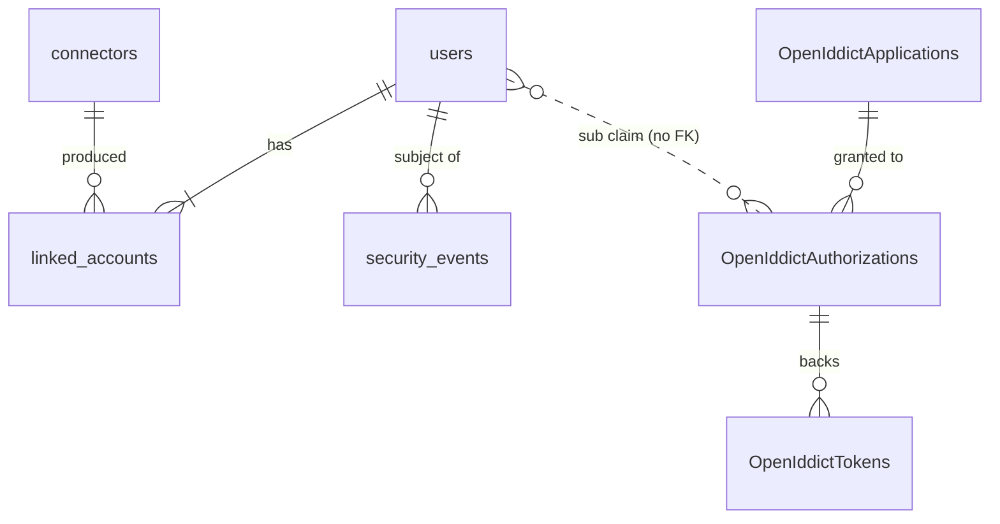
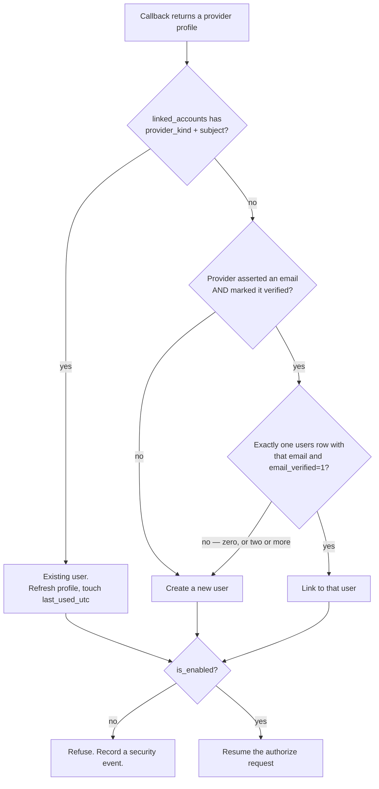

# Data Model: Umbral MVP

**Feature**: `001-umbral-mvp` | **Date**: 2026-10-09

One SQLite file at `/data/umbral.db`, in two lanes that never join:

- **Umbral's tables** (below) — raw `Microsoft.Data.Sqlite`, created by an
  idempotent `initializeSchema` in `Infrastructure/Database.fs`.
- **OpenIddict's four tables** — `OpenIddictApplications`, `OpenIddictAuthorizations`,
  `OpenIddictScopes`, `OpenIddictTokens`, owned by EF Core and migrated by
  `src/Umbral.Migrations`. Umbral never writes them directly; it goes through
  `IOpenIddictApplicationManager` and friends.

The link between the lanes is the `sub` claim: `users.id` is written into the
OIDC subject, and OpenIddict stores it as an opaque string. There is no foreign
key, by design — it is what lets the two lanes evolve independently.



---

## `users`

A person who has signed in at least once. Never created by an operator.

| Column | Type | Notes |
| --- | --- | --- |
| `id` | TEXT PK | A random 128-bit value, base64url. **This is the `sub` claim.** Not derived from any provider identifier, per FR-004. |
| `display_name` | TEXT NOT NULL | Best available from the providers; may be a placeholder. |
| `email` | TEXT NULL | The verified email, when one has ever been asserted. |
| `email_verified` | INTEGER NOT NULL | 0/1. Only ever 1 when a provider asserted verification. |
| `avatar_url` | TEXT NULL | Fully composed URL, never a raw hash. |
| `is_enabled` | INTEGER NOT NULL DEFAULT 1 | FR-022. |
| `first_seen_utc` | TEXT NOT NULL | ISO 8601. |
| `last_seen_utc` | TEXT NOT NULL | ISO 8601. |

Indexes: `UNIQUE(id)`; `INDEX(email) WHERE email_verified = 1`, which is the
lookup FR-012 performs on every first sign-in from a new provider account.

**Rules**

- `id` is generated once and never changes, for the lifetime of the row (FR-004).
- Disabling sets `is_enabled = 0`, revokes every OpenIddict authorization for
  that `sub`, and invalidates the Umbral session cookie. Re-enabling restores
  access and keeps the same `id`, so apps still recognise the person (FR-021.3).
- Deleting removes the row, cascades to `linked_accounts`, and revokes
  authorizations and tokens. A later sign-in with the same provider account
  creates a **new** user with a **new** `id` (FR-021.4).

---

## `linked_accounts`

One upstream provider account. A user may hold several (FR-012a). This is shown
inside a User in the admin UI, not as a top-level concept.

| Column | Type | Notes |
| --- | --- | --- |
| `user_id` | TEXT NOT NULL | FK → `users.id` ON DELETE CASCADE. |
| `provider_kind` | TEXT NOT NULL | `discord` \| `github` \| `google` \| `fake`. |
| `provider_subject` | TEXT NOT NULL | The provider's **immutable** id. See below. |
| `asserted_email` | TEXT NULL | What this provider said, which may differ from `users.email`. |
| `asserted_email_verified` | INTEGER NOT NULL | 0/1, as the provider marked it. |
| `linked_utc` | TEXT NOT NULL | |
| `last_used_utc` | TEXT NOT NULL | |

Indexes: `PRIMARY KEY (provider_kind, provider_subject)` — this is the identity
of the row and the lookup done on every sign-in; `INDEX(user_id)`.

**The immutable identifier per provider**, which must not be got wrong:

| Provider | Field | Type in JSON | Trap |
| --- | --- | --- | --- |
| Discord | `id` | **string** (a snowflake) | Parse as `UInt64` only when composing a default avatar index; store as the string. |
| GitHub | `id` | **int64** | `login` is **mutable and reusable**. Keying on it means a rename creates a new user and a squatted handle inherits an existing one. |
| Google | `sub` | string | Google's own docs say not to use `email` as the identifier. |

---

## The linking rule (FR-012)

This is the one piece of logic in the data model worth writing as a diagram,
because every branch is a decision someone will later ask about.



Two things this deliberately does not do:

- **It never links on an unverified email.** That is the account-takeover vector:
  a provider that lets someone claim `victim@example.com` without proving inbox
  control would otherwise hand over the victim's account.
- **It never guesses between two candidates.** Two existing users can legitimately
  share a verified email (both were created while a provider withheld the
  address). Creating a third user is the safe outcome; the operator can delete the
  strays.

---

## `connectors`

A configured upstream provider.

| Column | Type | Notes |
| --- | --- | --- |
| `slug` | TEXT PK | **Immutable** — it appears in the callback URL. Defaults to the kind. |
| `kind` | TEXT NOT NULL | `discord` \| `github` \| `google` \| `fake`. |
| `display_name` | TEXT NOT NULL | Mutable; shown on the sign-in button. |
| `client_id` | TEXT NOT NULL | |
| `client_secret_protected` | BLOB NOT NULL | Data-Protection ciphertext, purpose `Umbral.ConnectorSecrets.v1`. |
| `client_secret_hint` | TEXT NOT NULL | Last 4 characters, for the masked display. |
| `extra_scopes` | TEXT NULL | Space-separated, beyond the kind's required set. |
| `is_enabled` | INTEGER NOT NULL DEFAULT 1 | |
| `created_utc` / `updated_utc` | TEXT NOT NULL | |

**Deleting a connector** removes the row and the secret it holds, and nothing
else. `linked_accounts` has no foreign key to `connectors` — a link is keyed on
`provider_kind` and the provider's subject — so users, links, sessions and
tokens are untouched; only *new* sign-ins through it stop. Adding a connector of
the same kind back returns the same people to the same `sub`. Deleting the last
enabled connector asks first (FR-023).

**Deliberately absent**: `authorization_url`, `token_url`, `userinfo_url`, claim
mapping. Those are properties of the *kind*, compiled into F#. authentik and Ory
make them editable because they support a hundred providers; Umbral supports
three, and editable endpoints are surface area that only produces support
tickets. A future `Oidc of issuerUrl` case on the kind union is the additive way
to open this up.

**Separating `slug` from `display_name` is not cosmetic.** The slug is in
`/connect/{slug}/callback`, which the operator has registered in the provider's
console. Conflating the two means renaming a connector silently breaks every
login.

---

## `settings`

A one-row-per-key table for the handful of values that are neither a connector
nor an app.

| Key | Holds |
| --- | --- |
| `operator_credential` | PBKDF2 verification value, salt and iteration count. Never the credential. |
| `operator_credential_set_utc` | When it was last changed. |
| `schema_version` | Guards against a downgrade silently running on a newer file. |
| `instance_id` | Random, for log correlation. |

The public origin is **not** here — it is environment configuration (D4), because
a value that Umbral is wrong about must be fixable without Umbral starting.

---

## `security_events`

FR-035. Append-only.

| Column | Type | Notes |
| --- | --- | --- |
| `id` | INTEGER PK AUTOINCREMENT | |
| `occurred_utc` | TEXT NOT NULL | |
| `event_type` | TEXT NOT NULL | See below. |
| `outcome` | TEXT NOT NULL | `success` \| `failure`. |
| `actor` | TEXT NOT NULL | `operator` \| `user` \| `system`. |
| `user_id` | TEXT NULL | Not an FK: the event outlives the user. |
| `connector_slug` | TEXT NULL | |
| `client_id` | TEXT NULL | |
| `remote_ip` | TEXT NULL | From `UseForwardedHeaders`. |
| `detail` | TEXT NULL | Short, structured, **never a secret, token or authorization code**. |

Event types: `sign_in_succeeded`, `sign_in_failed`, `user_linked`, `user_created`,
`user_disabled`, `user_enabled`, `user_deleted`, `operator_signed_in`,
`operator_sign_in_failed`, `operator_credential_changed`, `connector_created`,
`connector_updated`, `connector_enabled`, `connector_disabled`,
`connector_deleted`, `app_created`, `app_secret_rotated`, `app_deleted`,
`authorization_code_replayed`, `config_applied`.

A redacting converter on the connector and settings types keeps a stray
structured-log call from serialising a secret.

---

## OpenIddict's lane

Umbral does not define these; it configures them. What matters for the plan:

- **An App is an `OpenIddictApplication`.** Created from the admin form through
  `IOpenIddictApplicationManager.CreateAsync(descriptor)` with
  `ClientType = Confidential`, `ApplicationType = Web`, `ConsentType = Implicit`,
  exact `RedirectUris`, and `Requirements = { ProofKeyForCodeExchange }`.
- **Permissions are derived, never checkboxes.** The admin form offers an app
  *type*; Umbral maps it to the permission set. A missing permission produces a
  half-working app — the authorize step succeeds and the token exchange fails —
  which is a terrible thing to let an operator build by hand. The web-app set is
  `ept:authorization`, `ept:token`, `ept:end_session`, `ept:revocation`,
  `gt:authorization_code`, `gt:refresh_token`, `rst:code`, `scp:email`,
  `scp:profile`. `openid` and `offline_access` need no scope permission.
- **The client secret is PBKDF2-hashed on write and cannot be read back.**
  `GetClientSecretAsync` returns the hash. This is why FR-019 says "shown once"
  and why the only recovery is rotation via
  `UpdateAsync(application, newSecret)`.
- **Authorizations are `Permanent`**, which is what makes refresh tokens and
  per-user revocation possible. Disabling a user revokes them.
- **Tokens are reference tokens** (D3), so a revoked authorization takes effect on
  the next use rather than at expiry.

---

## The configuration document

The declarative file of FR-027. Not a table — it is applied *into* the tables and
exported back out of them.

```yaml
version: 1

connectors:
  - slug: discord
    kind: discord
    display_name: Discord
    client_id: "1234567890"
    client_secret: ${UMBRAL_DISCORD_SECRET}   # env reference, never a literal
    enabled: true

apps:
  - client_id: grafana
    name: Grafana
    client_secret: ${UMBRAL_GRAFANA_SECRET}
    redirect_uris:
      - https://grafana.example.com/login/generic_oauth
```

Rules that make it idempotent (FR-027) and safe (FR-028, FR-030):

- `slug` and `client_id` are the identity. Applying twice is a no-op.
- `${VAR}` is the only accepted form for a secret. A literal is a **validation
  error**, not a warning — this is what keeps a secret out of the operator's git
  repository.
- Validation is whole-document and happens before anything is written, so a
  malformed file never half-applies.
- Export writes `${UMBRAL_<SLUG>_SECRET}` placeholders, so export → import
  round-trips given the environment (FR-029). App secrets cannot be exported at
  all — they are hashed — so an exported app is created with a fresh secret on
  import, and the export says so in a comment.

That last point is the one asymmetry in the round-trip, and it is forced by D6
rather than chosen. It must be in the documentation, not discovered.
