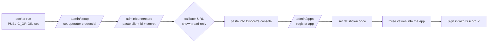

# Implementation Plan: Umbral MVP — Self-Hosted Social Login Provider

**Branch**: `001-umbral-mvp` | **Date**: 2026-10-09 | **Spec**: [spec.md](./spec.md)

**Input**: Feature specification from `/specs/001-umbral-mvp/spec.md`

## Summary

Build Umbral as a single F# ASP.NET Core application: OpenIddict issues the OIDC
tokens, three hand-rolled connectors delegate the actual authentication to
Discord, GitHub and Google, and an Oxpecker + htmx admin UI of three screens
configures all of it at runtime. One container, one SQLite file, one mounted data
directory.

The one architectural decision that shapes everything else: **the connectors do
not use ASP.NET Core's authentication handlers.** The product promise is that
pasting a client secret into a form works immediately, and the handler pipeline
binds options at startup. Working around that means replacing framework services
— Duende sells a component that does exactly this — to gain a pipeline whose
output we barely consume. Writing the OAuth client flow directly removes the
problem instead of fighting it, at the cost of owning `state`, PKCE and `nonce`
correctness. That cost is contained by writing those once, shared across all
three providers, and testing them as a state machine.

## Technical Context

**Language/Version**: F# on .NET 10 (`net10.0`)

**Primary Dependencies**: Oxpecker 2.1.1 · Oxpecker.ViewEngine 2.1.* ·
Oxpecker.Htmx 4.0.* · OpenIddict 7.7.1 (`OpenIddict.AspNetCore`,
`OpenIddict.EntityFrameworkCore`, `OpenIddict.Quartz`) ·
Microsoft.EntityFrameworkCore.Sqlite 10.0.11 · Microsoft.Data.Sqlite ·
YamlDotNet

**Storage**: SQLite at `/data/umbral.db`, WAL mode. OpenIddict's four tables
through EF Core; Umbral's six through raw `Microsoft.Data.Sqlite` with
hand-written SQL.

**Testing**: xunit v3 4.0.1 on Microsoft.Testing.Platform, `Microsoft.AspNetCore.TestHost`.
No Testcontainers — the database is a file.

**Target Platform**: Linux containers, `linux/amd64` and `linux/arm64`, on
`mcr.microsoft.com/dotnet/aspnet:10.0`

**Project Type**: Web service with a server-rendered admin UI. No frontend build
step, no bundler, no `wwwroot`.

**Performance Goals**: Not a throughput product. Tens to low hundreds of users,
a handful of apps, single-digit logins per minute at peak.

**Constraints**: Idle RSS under 150 MB (SC-007) · five minutes from `docker run`
to first login (SC-001) · tokens and sessions survive restart (SC-005) · no
runtime dependency outside the container (Principle II)

**Scale/Scope**: ~30 source files, 3 admin screens, 8 OIDC routes, 3 connectors

## Constitution Check

*GATE: evaluated before Phase 0 and again after Phase 1 design. Both passes
below.*

| Gate | Verdict | Evidence |
| --- | --- | --- |
| **Concept count** — a user-facing noun beyond App, Connector, User? | **Pass** | "Linked account" appears only inside a User (data-model). "Operator credential" is a setting, not a managed object. Three screens, per the admin contract. |
| **Single artifact** — a runtime dependency outside the container, or state outside the data directory? | **Pass** | SQLite file, key material and Data Protection ring all in `/data`. Quartz uses the in-memory store. No external service. |
| **Protocol safety** — hand-rolling token, signature or key handling OpenIddict provides? | **Pass, with one scoped exception** | OpenIddict owns every token Umbral issues. Umbral hand-rolls the *upstream OAuth client*, which OpenIddict does not provide dynamically — see Complexity Tracking row 1. |
| **Secure default** — is the secure behaviour the default? | **Pass** | PKCE required globally; exact redirect-URI matching; secrets encrypted or hashed on write and never displayed; HTTP refused unless an explicitly named env var is set in a non-Production environment. |
| **Config parity** — is every new capability expressible in YAML? | **Pass, with one documented asymmetry** | Connectors and apps round-trip. App *secrets* cannot be exported because OpenIddict hashes them; stated in the contract and the docs. |
| **Documentation** — does the task list include the doc change? | **Pass** | Phase 7 is documentation, and each connector task carries its provider walkthrough. |
| **Scope** — on the Principle VII exclusion list? | **Pass, with one wording conflict** | No RBAC, MFA, SAML, tenancy. FR-025 explicitly refuses a per-app allowlist. The operator credential collides with "no password-based local accounts" — Complexity Tracking row 2. |

**Post-design re-check**: unchanged. Phase 1 introduced no new user-facing noun,
no new external dependency, and no new storage engine.

## What changes

### 1. The composition root, built for testing on day one

`Program.fs` is the composition root and nothing else: DI, middleware order, and
the list of slice endpoints. The seam that matters:

```fsharp
/// The web app, composable so integration tests host the real thing on a TestServer.
let buildApp (args: string array) (customize: WebApplicationBuilder -> unit) : WebApplication =
    let builder = WebApplication.CreateBuilder(args)
    customize builder
    configureServices builder.Configuration builder.Services
    let app = builder.Build()
    configureApp app
    app
```

Every integration test calls `buildApp` with a customisation that points at a
temp SQLite file, stubs the provider `HttpMessageHandler`, and injects a fake
`TimeProvider`. No production code knows it is under test. Retrofitting this means
rewriting `Program.fs` and every test, so it is step one.

Middleware order is load-bearing and each entry earns its place:

```fsharp
app.UseForwardedHeaders()      // FIRST: scheme and client IP, before anything reads them
   .UseRouting()
   .UseAuthentication()        // OpenIddict's server handler runs HERE
   .UseRateLimiter()
   .UseAntiforgery()           // must sit between routing and the endpoints
   .Use(errorHandler)
   .UseOxpecker(endpoints)
   .Run(notFoundHandler)
```

`UseAuthentication()` before `UseOxpecker` is not style: OpenIddict's server
integration is an `IAuthenticationRequestHandler` and runs inside it. Get this
wrong and passthrough handlers execute before anything has been parsed.

### 2. OpenIddict, configured once and quarantined

All the `|> ignore` noise that F#-to-fluent-builder interop produces lives in
`Infrastructure/OpenIddictSetup.fs` so it does not spread:

```fsharp
services.AddOpenIddict()
    .AddCore(fun o ->
        o.UseEntityFrameworkCore().UseDbContext<UmbralDbContext>() |> ignore
        o.UseQuartz() |> ignore)
    .AddServer(fun o ->
        o.SetAuthorizationEndpointUris("connect/authorize")   // relative; route is absolute
         .SetTokenEndpointUris("connect/token")
         .SetUserInfoEndpointUris("connect/userinfo")         // capital I since 6.0
         .SetEndSessionEndpointUris("connect/logout")         // not SetLogoutEndpointUris
         .SetRevocationEndpointUris("connect/revoke")
         .SetIntrospectionEndpointUris("connect/introspect") |> ignore

        o.AllowAuthorizationCodeFlow()
         .RequireProofKeyForCodeExchange()
         .AllowRefreshTokenFlow() |> ignore

        o.UseReferenceAccessTokens()                          // so revocation is real
         .UseReferenceRefreshTokens() |> ignore

        o.SetIssuer(publicOrigin) |> ignore                   // never inferred from the request
        o.RegisterScopes([| Scopes.OpenId; Scopes.Email; Scopes.Profile; Scopes.OfflineAccess |]) |> ignore

        // OpenIddict 7.0 turned these on by default. Pure OIDC clients send
        // neither, so nothing breaks today — but the first one that does would
        // fail opaquely. Off, deliberately.
        o.DisableAudienceValidation().DisableResourceValidation() |> ignore

        o.AddSigningCertificate(Keys.loadOrCreate signingPath)
         .AddEncryptionCertificate(Keys.loadOrCreate encryptionPath) |> ignore

        o.UseAspNetCore()
         .EnableAuthorizationEndpointPassthrough()
         .EnableUserInfoEndpointPassthrough()
         .EnableEndSessionEndpointPassthrough()
         .EnableErrorPassthrough() |> ignore)
    |> ignore
```

**Token-endpoint passthrough is deliberately absent.** Without it OpenIddict
handles `authorization_code` and `refresh_token` itself — PKCE verification,
client authentication, rolling refresh rotation — for zero code. It is added in
Phase 6, when refresh must re-check whether a user has since been disabled.

### 3. The authorize handler, and the one line everyone forgets

OpenIddict has already validated the request when this runs. The handler decides
whether the person is authenticated, challenges the connector picker if not, and
signs in with the OpenIddict scheme.

```fsharp
let handler : EndpointHandler =
    fun ctx ->
        task {
            let request = ctx.GetOpenIddictServerRequest()
            // A null here means the route and Set*EndpointUris disagree.
            if isNull (box request) then failwith "OIDC request not retrievable"

            match! ctx.AuthenticateAsync(CookieAuthenticationDefaults.AuthenticationScheme) with
            | r when not r.Succeeded || request.HasPromptValue(PromptValues.Login) ->
                return! challengeToPicker ctx request
            | r ->
                let! user = Users.find (ctx.GetService<DbConfig>()) (r.Principal.GetClaim Claims.Subject)
                match user with
                | Some u when u.IsEnabled ->
                    let identity = buildIdentity u (r.Principal.GetClaim "idp") request
                    // Without this, the id_token carries only sub/iss/aud/exp,
                    // silently, with no error anywhere.
                    identity.SetDestinations(Func<Claim, string seq>(destinationsFor)) |> ignore
                    return! ctx.SignInAsync(
                        OpenIddictServerAspNetCoreDefaults.AuthenticationScheme,
                        ClaimsPrincipal identity)
                | _ -> return! forbidDisabled ctx
        }

let endpoint = [ GET  [ route "/connect/authorize" handler ]
                 POST [ route "/connect/authorize" handler ] ]
```

A claim with no destination is dropped from both tokens, silently. This is
OpenIddict's design, it is the single likeliest defect in the build, and the test
for it asserts the **claim content of a real issued token**, not the construction
of the identity.

### 4. Connectors: a SQLite row read inside the request

No scheme registration, no options cache, no restart. The two routes per
connector and the shared round-trip machinery are specified in
[contracts/connectors.md](./contracts/connectors.md). The shape:

```fsharp
// Infrastructure/OAuthRoundTrip.fs — written ONCE, shared by all three adapters.
let begin' (ctx: HttpContext) (slug: string) (returnUrl: string) : Correlation
let complete (ctx: HttpContext) (slug: string) : Result<Correlation, RoundTripError>
```

`complete` validates the cookie, compares `state` in constant time, **deletes the
cookie before doing anything else** so a replay finds nothing, rejects a
correlation older than ten minutes, and rejects a path slug that disagrees with
the stored one. Every provider-specific file below it is plumbing.

### 5. Three admin screens, mostly forms

Baseline is a form POST, a 302, and a flash — the reference repository's actual
pattern. htmx intercepts exactly three interactions where a full reload is worse:
the connector enable/disable toggle, saving connector credentials, and the user
enable/disable toggle. Each is a real form that works with htmx off.

```fsharp
// A slice that serves both paths.
let private respond ctx t content =
    if ctx.TryGetHeaderValue HxRequestHeader.Request |> Option.isSome
    then ctx.WriteHtmlView content                      // bare fragment
    else ctx.WriteHtmlView(content |> Layout.page ctx t) // full page
```

Note `hxPartial` arrived in Oxpecker.Htmx 4.1 and is **not available** in the
pinned 4.0 — the `HX-Request` header branch above is the supported way.

### 6. The five-minute path

What SC-001 actually measures, and what the build must make true:



The read-only callback field at **D** is the single highest-leverage element in
the product. Without it the operator guesses a URL, Discord rejects the callback,
and the error names neither.

### Project structure

```text
specs/001-umbral-mvp/
├── plan.md              # this file
├── spec.md
├── research.md          # Phase 0 — the decisions, D1–D13
├── data-model.md        # Phase 1
├── quickstart.md        # Phase 1
├── contracts/
│   ├── oidc-provider.md
│   ├── connectors.md
│   └── admin-and-config.md
└── tasks.md             # /speckit-tasks — NOT created by /speckit-plan
```

Source. F# compile order **is** the dependency graph, so this listing is also the
`<Compile Include>` order:

```text
global.json                       # {"test":{"runner":"Microsoft.Testing.Platform"}}
Umbral.slnx
src/Umbral/                       # Microsoft.NET.Sdk.Web
├── Domains/                      # pure types and functions, no I/O
│   ├── Ids.fs                    #   subject generation, slug validation
│   ├── Connectors.fs             #   ProviderKind DU, per-kind endpoints and scopes
│   ├── Users.fs                  #   User, LinkedAccount, the FR-012 linking rule (pure)
│   └── ConfigDocument.fs         #   YAML document types + whole-document validation
├── Infrastructure/
│   ├── Database.fs               #   connection, WAL pragmas, idempotent initializeSchema
│   ├── PublicOrigin.fs           #   parse, validate, fail fast
│   ├── Keys.fs                   #   load-or-create signing/encryption PFX
│   ├── Secrets.fs                #   IDataProtector wrapper, redacting converters
│   ├── SecurityEvents.fs
│   ├── AdminAuth.fs              #   operator credential, cookie scheme, requireOperator
│   ├── OAuthRoundTrip.fs         #   state + PKCE + nonce. Written once.
│   ├── ProviderAdapters.fs       #   IProviderAdapter + Discord/GitHub/Google/Fake
│   ├── ConnectorStore.fs
│   ├── UserStore.fs              #   resolve-or-create from a ProviderProfile
│   ├── ConfigFile.fs             #   load, apply (idempotent), export
│   └── OpenIddictSetup.fs        #   all the fluent-builder interop, quarantined
├── Views/                        # Texts -> Theme -> Components -> Layout
├── Handlers/                     # one file per endpoint
│   ├── Health.fs
│   ├── Connect/                  #   Authorize, UserInfo, EndSession, Error,
│   │                             #   Picker, Start, Callback
│   └── Admin/                    #   Setup, SignIn, SignOut, Apps, AppCreate,
│                                 #   AppSecret, AppDelete, Connectors, ConnectorSave,
│                                 #   ConnectorToggle, ConnectorDelete, Users,
│                                 #   UserToggle, UserDelete, ConfigExport
└── Program.fs                    # LAST
src/Umbral.Migrations/            # C#. EF migrations for OpenIddict's four tables only.
tests/Umbral.Tests/
├── Infrastructure/               # Fixtures, Browser, FakeProvider, Db helpers
├── Fixtures/                     # captured real provider responses
└── *Tests.fs
Dockerfile
```

**Structure Decision**: one F# web project, one test project, one small C#
migrations project. The reference repository's single-project layout, plus the
migrations project that EF Core's C#-only scaffolding forces (Complexity Tracking
row 3).

Adding an endpoint is a three-step ritual — new file, `<Compile Include>` before
`Program.fs`, and the `endpoint` added to `Program.endpoints`. Missing the third
produces a silent 404 with no error anywhere, so a meta-test asserts every handler
module's `endpoint` appears in the list.

## Steps

### Phase 0 — De-risk

- [ ] 1. **C# spike, then delete it.** Copy the OpenIddict Velusia sample's two
      files, point at SQLite, register one client, get a token out with `curl`.
      There is no production F# + OpenIddict integration anywhere to copy from, and
      debugging an unfamiliar library and an unfamiliar interop pattern at the same
      time is how a week disappears. Ends with a known-good reference to diff
      against.
- [ ] 2. **Verify Discord PKCE empirically** against a real Discord app. Discord
      does not document it; two third-party sources say `S256` only. Result sets
      the per-kind capability flag.

### Phase 1 — Skeleton (User Story 2 foundation)

- [ ] 3. Solution, `global.json`, both projects, the pinned package versions.
- [ ] 4. `Program.buildApp` seam, middleware order, `/healthz`, the error handler,
      and one integration test that boots the app on a `TestServer`.
- [ ] 5. `Infrastructure/PublicOrigin.fs` — parse, validate, refuse to start when
      unset. Tests for the reverse-proxy and trailing-slash cases.
- [ ] 6. `Infrastructure/Database.fs` — connection, WAL, `initializeSchema` for the
      six Umbral tables; `src/Umbral.Migrations` for OpenIddict's four.
- [ ] 7. `Infrastructure/Keys.fs` — load-or-create the PFX pair in `/data/keys`;
      Data Protection persisted to the same directory. Test: two successive boots
      produce the same key.
- [ ] 8. `Views/` — Texts, Theme, Components, Layout. No frontend build step.

### Phase 2 — OIDC provider (User Story 2)

- [ ] 9. `Infrastructure/OpenIddictSetup.fs` and the EF Core `DbContext`.
- [ ] 10. `Handlers/Connect/Authorize.fs`, including `destinationsFor`.
- [ ] 11. `Handlers/Connect/UserInfo.fs`, `EndSession.fs`, `Error.fs`.
- [ ] 12. **Conformance test**: drive an off-the-shelf OIDC client library through
      a full authorization-code + PKCE login and validate the `id_token` against
      the published JWKS. Asserts the claim content of a real token.

### Phase 3 — Connectors (User Story 1)

- [ ] 13. `Infrastructure/OAuthRoundTrip.fs` and its state-machine tests —
      missing cookie, missing `state`, mismatched `state`, expired, replayed,
      `access_denied`, slug mismatch. Written before any provider.
- [ ] 14. `IProviderAdapter` + the `Fake` kind, hard-gated, with the test asserting
      it cannot be enabled in Production.
- [ ] 15. Discord adapter + captured fixtures (null avatar, both default-index
      formulas, `a_` animated hash, form-encoded token endpoint).
- [ ] 16. GitHub adapter + fixtures (form-encoded token response, private email →
      `/user/emails`, verified-but-not-primary, HTTP 200 carrying an `error`).
- [ ] 17. Google adapter + fixtures (`email_verified: false`, both accepted `iss`
      spellings, the §3.1.3.7 comment).
- [ ] 18. `Handlers/Connect/Picker.fs`, `Start.fs`, `Callback.fs`.
- [ ] 19. `Infrastructure/UserStore.fs` — the FR-012 linking rule, with tests for
      every branch of the flowchart in data-model.md, including two existing users
      sharing a verified email.

### Phase 4 — Admin UI (User Stories 1, 3, 4)

- [ ] 20. `Infrastructure/AdminAuth.fs`, `/admin/setup`, `/admin/signin`,
      `/admin/signout`, the `requireOperator` combinator, rate limiting, and the
      offline credential-reset path (FR-017b).
- [ ] 21. Connectors screen: list, save credentials, toggle, delete, the read-only
      callback URL, the origin-mismatch banner, and the Google-rejects-IP-addresses
      notice.
- [ ] 22. Apps screen: register, the shown-once secret, regenerate, delete.
      Permissions derived from an app-type choice, never checkboxes.
- [ ] 23. Users screen: list, search, enable, disable, delete; disabling revokes
      OpenIddict authorizations and kills the session.
- [ ] 24. The three htmx interactions, each with a working no-htmx fallback and a
      test for both paths.

### Phase 5 — Config as code (User Story 5)

- [ ] 25. `Domains/ConfigDocument.fs` + `Infrastructure/ConfigFile.fs`: load,
      whole-document validation, idempotent apply, export. Tests for apply-twice,
      a literal secret, a missing env var, and a malformed document.
- [ ] 26. `GET /admin/config` export, round-trip test on a second clean instance.

### Phase 6 — Hardening

- [ ] 27. Token-endpoint passthrough, re-checking `is_enabled` on refresh.
- [ ] 28. `SecurityEvents` on every event type in data-model.md; redacting
      converters; a test that no secret, token or code reaches a log.
- [ ] 29. Rate limiting on sign-in and admin authentication (FR-038).
- [ ] 30. Meta-tests: every `endpoint` is in `Program.endpoints`; no committed
      settings file holds a secret; SQL text is literal.
- [ ] 31. Quartz pruning; restart test (SC-005); idle-RSS test (SC-007).

### Phase 7 — Ship

- [ ] 32. Multi-arch Dockerfile, `/data` volume, both architectures built.
- [ ] 33. README: zero to a working login without leaving the page (FR-040).
- [ ] 34. Three provider walkthroughs — where to create the OAuth app, which
      redirect URI, which scopes (FR-039).
- [ ] 35. Review every operator-facing string in `Views/Texts.fs` against SC-010:
      each names the next action.

## How it is verified

- [ ] `dotnet test` passes. Filters are `--filter-class` / `--filter-method`
      (Microsoft.Testing.Platform), not VSTest's `--filter`.
- [ ] An off-the-shelf OIDC client library completes a login with only issuer,
      client ID and client secret, and the `id_token` validates against the
      published JWKS (SC-002, SC-003).
- [ ] A timed run of the quickstart from `docker run` to first login finishes
      inside five minutes, excluding time in the provider's console (SC-001).
- [ ] Replacing a connector secret and toggling a connector take effect on the
      next sign-in with the process never restarting (SC-004).
- [ ] `docker restart` leaves signed-in people signed in and previously issued
      tokens valid (SC-005).
- [ ] A clean instance started from an exported config plus its environment is
      functionally identical, with no admin UI interaction (SC-006).
- [ ] Idle RSS under 150 MB; images for `linux/amd64` and `linux/arm64` (SC-007).
- [ ] No secret is readable from the admin UI, the config export, or the logs
      after being saved (SC-008).
- [ ] A disabled user loses access within one sign-in attempt and holds no usable
      token (SC-009).
- [ ] A reader following only the README reaches a working login (SC-011).

## Decisions

| Decision | Choice | Why |
| --- | --- | --- |
| Upstream OAuth client | Hand-rolled behind `IProviderAdapter` | The handler pipeline binds options at startup; `OAuthOptions.Validate()` throws on the empty credentials a fresh install has; Duende replaces framework services to fix this. Hand-rolling removes the problem. Shared `state`/PKCE/`nonce` code caps the risk. |
| OpenIddict client stack for the social leg | Rejected for v1 | Ships Discord/GitHub/Google and is already a dependency — but its maintainer calls dynamic registration unsupported and both workarounds hacks. Would also couple both halves to one version. Revisit at v2; the seam makes it a one-implementation swap. |
| OpenIddict storage | EF Core + SQLite, OpenIddict's tables only | Only EF Core, EF6 and Mongo stores exist. Custom stores are weeks of work on the most security-critical path — against Principle III. Umbral's own tables stay on raw SQLite. |
| Token format | Reference access and refresh tokens | FR-022 demands revocation actually take effect. Self-contained JWTs only bound the window. Also sidesteps OpenIddict's default access-token encryption, which confuses every developer who tries to decode one. |
| Token-endpoint passthrough | Off until Phase 6 | OpenIddict handles both grants itself, correctly, for zero code. Added only when refresh must re-check a disabled user. |
| Public origin | Required env var; never inferred | A request-derived `redirect_uri` behind a proxy mismatches what the operator registered, and the resulting error names neither the proxy nor the setting. |
| Google `id_token` signature | Not verified; claims are | OIDC Core §3.1.3.7 permits TLS server validation instead, for a token received directly from the token endpoint. Avoids hand-rolling JWKS caching and rotation. Comment cites the clause. |
| htmx | Three interactions, not everywhere | Three screens of forms do not need a second rendering path per slice. The reference repo loads htmx and uses it nowhere, so there is no house pattern to inherit. |
| Localization | English only; `Views/Texts.fs` kept | Retrofitting ~200 strings is miserable, and SC-010 is auditable by reading one file. |
| Container base | Debian `aspnet:10.0`, not Alpine | Alpine adds a musl RID dimension to SQLite's native asset; a missing `e_sqlite3.so` is a classic ARM failure. Revisit once the image is proven. |

> **Open — carried from the spec.** FR-012 (link on a verified email), FR-017
> (one operator credential set at first run) and FR-025 (any user, any app) were
> answered by assumption so the plan would not stall. Each is cheap to reverse
> now and expensive later. Confirm or correct them at this review.

## Complexity Tracking

| Violation | Why needed | Simpler alternative rejected because |
| --- | --- | --- |
| Hand-rolled upstream OAuth client, against Principle III's "delegate to a certified library" | Principle III is about *the protocol Umbral serves*. Nothing certified provides a runtime-reconfigurable OAuth client, which FR-010 requires. | `AddOAuth` + options-cache eviction: empty day-zero credentials fail `Validate()`, and fixing it properly means replacing framework services. OpenIddict's client: dynamic registration explicitly unsupported. |
| An operator credential, against Principle VII's "no password-based local accounts" | A clean install has no connectors, so connector-based admin bootstrap has nothing to sign in with. Independence from connectors also prevents lock-out when a provider credential expires. | Connector-based admin: cannot bootstrap, and a provider outage locks the operator out of the screen needed to fix it. **Proposed amendment**: narrow Principle VII to "no password-based accounts **for end users**", at constitution v1.1.0. |
| A second project, `src/Umbral.Migrations` (C#), against the single-artifact shape | EF Core's design-time tooling scaffolds C# only, and OpenIddict's schema must be migrated across versions for an appliance users upgrade in place. | Hand-written F# migrations: fragile against OpenIddict's entity model changing. `EnsureCreated()`: no upgrade path, explicitly disclaimed by the samples. The project ships no code into the container. |
| Two data-access styles on one SQLite file | OpenIddict requires EF Core; Umbral's own tables are six flat tables where an ORM earns nothing. | EF Core for everything: F# entity types plus C# migrations for every table, to unify two lanes that never join. |

## Risks

- **No F# + OpenIddict prior art exists.** Mitigated by the C# spike in step 1 —
  port working code rather than debug two unknowns at once.
- **Discord's PKCE support is undocumented.** Mitigated by a per-kind capability
  flag and the empirical check in step 2.
- **Google will not accept a raw-IP redirect URI**, which breaks the most natural
  homelab URL. Not fixable in code; mitigated by saying so in the UI at the moment
  Google is chosen, and by ordering connectors Discord, GitHub, Google.
- **Losing `/data/keys` makes every stored connector secret undecryptable and logs
  everyone out.** Mitigated by generating into the mounted volume and by stating
  the backup requirement in the README and the Dockerfile.
- **SD-card wear**: reference tokens write a row per issuance. Mitigated by Quartz
  pruning and a documented preference for `/data` on an SSD.
- **The silent-404 trap**: a handler whose `endpoint` is not in `Program.endpoints`
  fails with no error anywhere. Mitigated by the meta-test in step 30.

## Out of scope

- SAML, LDAP, any role or permission model, MFA, local password accounts for end
  users, custom login flows, multi-tenancy — permanently, per Principle VII.
- Per-app connector restriction (FR-025 option b). The obvious v2 addition; a
  field on App and a checkbox group, additive.
- Unlinking an individual provider account from a user (FR-012b).
- Per-app login page branding.
- A generic `Oidc of issuerUrl` connector kind. The `ProviderKind` union is shaped
  to make it additive.
