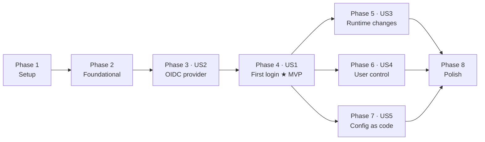

# Tasks: Umbral MVP — Self-Hosted Social Login Provider

**Input**: Design documents from `/specs/001-umbral-mvp/`

**Prerequisites**: [plan.md](./plan.md), [spec.md](./spec.md), [research.md](./research.md), [data-model.md](./data-model.md), [contracts/](./contracts)

**Tests**: Included. The constitution's "Development Workflow & Quality Gates" makes them mandatory: every OIDC protocol behaviour needs a test against the real endpoint, every connector must be testable without real credentials, and a bug fix must add the test that would have caught it.

## Format: `[ID] [P?] [Story] Description`

- **[P]**: Can run in parallel — different files, no dependency on an incomplete task
- **[Story]**: The user story this serves (US1–US5)

## The three-step ritual

Every task that adds a handler file has **three** parts, and missing the third produces a silent 404 with no error anywhere:

1. the file under `src/Umbral/Handlers/`
2. `<Compile Include>` in `src/Umbral/Umbral.fsproj`, **before** `Program.fs`
3. the `endpoint` added to `Program.endpoints`

T102 adds the meta-test that makes a missed step 3 fail the build instead of failing silently. Until it lands, check by hand.

---

## Phase 1: Setup

**Purpose**: De-risk the unknowns, then stand up the projects.

- [x] T001 Build a throwaway C# OpenIddict spike in `/tmp/umbral-spike`: copy the Velusia sample's `Program.cs` and `AuthorizationController.cs`, point them at SQLite, register one client, and obtain an `id_token` via authorization-code + PKCE with `curl`. **There is no production F# + OpenIddict integration anywhere to copy from** — this produces the known-good reference to diff against when the F# port misbehaves. Delete the spike after T030.
- [ ] T002 [P] **BLOCKED — needs a real Discord OAuth app from the project owner.** Verify Discord's PKCE support empirically against a real Discord OAuth app: send `code_challenge_method=S256` and confirm the exchange succeeds. Discord does not document PKCE; two third-party sources claim `S256`-only. Record the result in [research.md](./research.md) under "Open items".
- [x] T003 Create `Umbral.slnx` and `global.json` containing `{"test":{"runner":"Microsoft.Testing.Platform"}}` at the repository root.
- [x] T004 Create `src/Umbral/Umbral.fsproj` (`Microsoft.NET.Sdk.Web`, `net10.0`) with pinned packages: `Oxpecker` 2.1.1, `Oxpecker.ViewEngine` 2.1.*, `Oxpecker.Htmx` 4.0.*, `OpenIddict.AspNetCore` 7.7.1, `OpenIddict.EntityFrameworkCore` 7.7.1, `OpenIddict.Quartz` 7.7.1, `Microsoft.EntityFrameworkCore.Sqlite` 10.0.11, `Microsoft.Data.Sqlite`, `YamlDotNet`, `Quartz.Extensions.Hosting`.
- [x] T005 [P] Create `tests/Umbral.Tests/Umbral.Tests.fsproj` (`Microsoft.NET.Sdk`, `<OutputType>Exe</OutputType>`) with `xunit.v3` 4.0.1, `Microsoft.NET.Test.Sdk` 18.10.1, `Microsoft.AspNetCore.TestHost` 10.0.*. Set `<DefaultItemExcludes>$(DefaultItemExcludes);tests/**</DefaultItemExcludes>` in `src/Umbral/Umbral.fsproj` if the test project nests under it.
- [x] T006 [P] Create `src/Umbral.Migrations/Umbral.Migrations.csproj` (C#, `net10.0`) with `Microsoft.EntityFrameworkCore.Design`. It holds EF migrations for OpenIddict's four tables only and ships no code into the container.
- [x] T007 [P] Add `.gitignore` and `.dockerignore` covering `bin/`, `obj/`, `*.db`, `*.db-wal`, `*.db-shm`, `*.pfx`, `/data`.
- [x] T008 Add a `Directory.Build.props` setting `TreatWarningsAsErrors` and `WarningsNotAsErrors` for the F# warnings that fight the Oxpecker view DSL.

**Checkpoint**: `dotnet build` succeeds on an empty solution.

---

## Phase 2: Foundational

**Purpose**: Blocking prerequisites. **No user story can start until this phase is done.**

### The test seam, first

- [ ] T009 Write `src/Umbral/Program.fs` with `buildApp (args: string array) (customize: WebApplicationBuilder -> unit) : WebApplication`, `configureServices`, `configureApp`, and an empty `endpoints` list. **Build this on day one** — every test depends on it, and retrofitting means rewriting `Program.fs` and every test.
- [ ] T010 Set the middleware order in `configureApp`, with a comment on each line saying why it is there: `UseForwardedHeaders` → `UseRouting` → `UseAuthentication` → `UseRateLimiter` → `UseAntiforgery` → error handler → `UseOxpecker` → 404. `UseAuthentication` **must** precede `UseOxpecker`, because OpenIddict's server integration runs inside it as an `IAuthenticationRequestHandler`.
- [ ] T011 [P] Create `tests/Umbral.Tests/Infrastructure/Fixtures.fs` providing `newApp ()` — a fresh SQLite file in a temp directory, `UseTestServer`, stubbed provider `HttpMessageHandler`, injectable `TimeProvider` — disposed at the end of each test. No Testcontainers: the database is a file.
- [ ] T012 [P] Create `tests/Umbral.Tests/Infrastructure/Browser.fs` — a cookie-keeping client over the TestServer that follows redirects, exposes `Get`, `PostForm(formPage, action, fields)` which scrapes the antiforgery token from the form page so CSRF is exercised for real, and `PostFormWithoutToken` for the CSRF tests themselves.
- [ ] T013 [P] Create `tests/Umbral.Tests/Infrastructure/Db.fs` with `scalar`, `count` and `dump` helpers for asserting against the database.
- [ ] T014 Write `tests/Umbral.Tests/SmokeTests.fs` asserting the app boots on a TestServer and `/healthz` returns 200.

### Configuration and storage

- [x] T015 Create `src/Umbral/Domains/Ids.fs`: subject generation (128 random bits, base64url — **not** derived from any provider identifier, per FR-004) and slug validation (`^[a-z0-9-]{1,32}$`).
- [x] T016 [P] Create `src/Umbral/Infrastructure/PublicOrigin.fs`: parse and validate `UMBRAL__PUBLIC_ORIGIN` — absolute URI, scheme `https` or `http` only for `localhost`/`127.0.0.1`/`[::1]`, no path, no query, no fragment, trailing slash normalised away, host lowercased. **Refuse to start when unset**, with a message naming the variable and giving an example.
- [x] T017 [P] Write `tests/Umbral.Tests/PublicOriginTests.fs` covering: unset, trailing slash, uppercase host, a path component, `http` on a non-localhost host, and an IPv6 literal.
- [x] T018 Create `src/Umbral/Infrastructure/Database.fs`: connection factory, `PRAGMA journal_mode=WAL` and `PRAGMA busy_timeout=5000` on open, and an idempotent `initializeSchema` creating the six Umbral tables from [data-model.md](./data-model.md) — `users`, `linked_accounts`, `connectors`, `settings`, `security_events`, plus indexes including `INDEX(email) WHERE email_verified = 1`.
- [ ] T019 Create `src/Umbral/Infrastructure/UmbralDbContext.fs` (EF Core) calling `options.UseOpenIddict()`, and wire `AddDbContext` plus `AddScoped<UmbralDbContext>` — OpenIddict 7.0 no longer auto-registers the context.
- [ ] T020 Generate the initial EF migration into `src/Umbral.Migrations` and apply it at startup with `MigrateAsync()`. Safe here because one container is one writer.
- [x] T021 [P] Write `tests/Umbral.Tests/DatabaseTests.fs`: `initializeSchema` is idempotent across two runs; WAL is active; migrations create OpenIddict's four tables.

### Keys and secrets

- [x] T022 Create `src/Umbral/Infrastructure/Keys.fs`: `loadOrCreate path subject usage` — load a PFX if present, otherwise generate a self-signed 4096-bit RSA certificate with a five-year validity via `CertificateRequest`, write it to `/data/keys` with Unix mode 0600, and return it. **Never `AddDevelopmentSigningCertificate`**: it stores keys in the container's writable layer, so the first `docker compose pull` would invalidate every issued token and log every user out.
- [ ] T023 Persist the Data Protection key ring with `PersistKeysToFileSystem(/data/keys)` and `SetApplicationName("Umbral")`. It protects the admin cookie, the antiforgery tokens and the connector secrets — a different concern from T022 with the same failure mode.
- [x] T024 [P] Write `tests/Umbral.Tests/KeyPersistenceTests.fs`: two successive boots against the same directory produce the same certificate thumbprint, and a token issued before a simulated restart still validates after it.
- [x] T025 [P] Create `src/Umbral/Infrastructure/Secrets.fs`: an **`ISecretStore` seam** (Put/Get/Delete over a `SecretRef` of `<store>:<locator>`) with `LocalSecretStore` — `IDataProtector` under the purpose `Umbral.ConnectorSecrets.v1` — as the only implementation, plus `hint`/`masked` and a `Protected` type whose `ToString` is `[redacted]`. The seam is deliberate: an external secret manager must be addable without a schema migration on every deployed instance.
- [ ] T026 [P] Create `src/Umbral/Infrastructure/SecurityEvents.fs` with a `record` function and the closed event-type union listed in [data-model.md](./data-model.md). The `detail` field must never carry a secret, token or authorization code.

### Views

- [x] T027 [P] Create `src/Umbral/Views/Texts.fs` — a single record type holding **every** user-facing string. No literal text in any view, ever. English only, but the record stays so SC-010 is auditable by reading one file.
- [x] T028 [P] Create `src/Umbral/Views/Theme.fs` — colour, type and radius tokens as F# data that generate both the CSS custom properties and the Tailwind CDN config, plus a closed `Icon` union used to subset the icon font. No npm, no bundler, no `wwwroot`.
- [x] T029 Create `src/Umbral/Views/Components.fs` and `src/Umbral/Views/Layout.fs` — `Layout.page ctx t title content`, `Layout.messagePage`, and the shared card/button/field/pill components. Compile order is `Texts → Theme → Components → Layout`.

**Checkpoint**: the app boots, `/healthz` answers, keys persist, schema initialises. User stories can start.

---

## Phase 3 (US2 — P1): Drop-in OIDC for any app

**Goal**: A developer points any standard OIDC client library at the issuer URL with three values and it works.

**Independent test**: Seed a user directly in the database, register an app, and drive an off-the-shelf OIDC client library — one that knows nothing about Umbral — through a full authorization-code + PKCE login. Validate the `id_token` against the published key set. No connectors needed.

- [ ] T030 [US2] Create `src/Umbral/Infrastructure/OpenIddictSetup.fs` with the full `AddOpenIddict()` configuration from [plan.md](./plan.md): endpoint URIs (**relative**, no leading slash — they resolve against `PathBase`), authorization-code + refresh flows, `RequireProofKeyForCodeExchange()`, `UseReferenceAccessTokens()` and `UseReferenceRefreshTokens()`, `SetIssuer(publicOrigin)`, registered scopes and claims, the T022 certificates, `DisableAudienceValidation()` and `DisableResourceValidation()` with a comment explaining the 7.0 default change, and `UseAspNetCore()` passthrough for authorization, user-info and end-session. **Do NOT enable `EnableErrorPassthrough()` here** — T001 proved it is not inert: with it on and no error handler written, every request OpenIddict would reject cleanly (missing PKCE, bad `redirect_uri`) becomes an `InvalidOperationException` and an HTTP 500. It goes in with T036. **No token-endpoint passthrough** — T091 adds it. Quarantine all the `|> ignore` interop here so it does not spread.
- [ ] T031 [US2] Add `UseQuartz()` and register `AddQuartz` with the in-memory store plus `AddQuartzHostedService`, so the token table does not grow forever.
- [ ] T032 [US2] Create `src/Umbral/Handlers/Connect/Authorize.fs`: read `GetOpenIddictServerRequest()` (**a null here means the route and `Set*EndpointUris` disagree** — fail with that message), authenticate the cookie scheme, challenge the picker when absent or `prompt=login`, return `login_required` for `prompt=none`, build the `ClaimsIdentity` with `TokenValidationParameters.DefaultAuthenticationType`, create or reuse a `Permanent` authorization, and `SignInAsync` with the OpenIddict scheme. Routes: `GET` and `POST /connect/authorize`.
- [ ] T033 [US2] Implement `destinationsFor` in the same file: `name`/`preferred_username`/`picture` → access token, plus id token when the `profile` scope is present; `email`/`email_verified` → access token, plus id token with the `email` scope; `idp` → both. **A claim with no destination is silently dropped from both tokens.** This is the single likeliest defect in the build.
- [ ] T034 [P] [US2] Create `src/Umbral/Handlers/Connect/UserInfo.fs` returning the same identity as the `id_token` for a given access token (FR-005).
- [ ] T035 [P] [US2] Create `src/Umbral/Handlers/Connect/EndSession.fs` — sign out of the cookie scheme and honour `post_logout_redirect_uri` when registered.
- [ ] T036 [US2] Create `src/Umbral/Handlers/Connect/Error.fs` **and enable `EnableErrorPassthrough()` in the same change** — the switch and its handler must land together (T001). Renders Umbral's own error page. It must disclose no configuration detail (FR-037).
- [ ] T037 [US2] Write `tests/Umbral.Tests/DiscoveryTests.fs`: `issuer` equals `UMBRAL__PUBLIC_ORIGIN` exactly; `grant_types_supported` contains neither `implicit` nor `password`; `code_challenge_methods_supported` does not contain `plain`; every endpoint listed in [contracts/oidc-provider.md](./contracts/oidc-provider.md) is advertised.
- [ ] T038 [US2] Write `tests/Umbral.Tests/AuthorizationCodeFlowTests.fs` driving a full authorization-code + PKCE login end to end and validating the `id_token` signature against `/.well-known/jwks`.
- [ ] T039 [US2] Write `tests/Umbral.Tests/TokenClaimsTests.fs` asserting the **claim content of a real issued token** — not the construction of the identity. This is the regression test for T033; without it a dropped destination ships silently. Also assert `email_verified` is a JSON **boolean**, not the string `"true"`: `SetClaim` has 15+ overloads and the string one is the easy mistake, after which an app doing `if (claims.email_verified)` treats `"false"` as true.
- [ ] T040 [P] [US2] Write `tests/Umbral.Tests/ProtocolRejectionTests.fs`: a `redirect_uri` that is not an exact registered match is rejected **without redirecting**; a request without PKCE is rejected; a replayed authorization code yields `invalid_grant` and records an `authorization_code_replayed` event.
- [ ] T105 [US2] Reject `plain` PKCE. T001 proved OpenIddict 7.7.1 advertises `["plain", "S256"]` and **accepts `plain` end to end**, and that `RequireProofKeyForCodeExchange()` is the only PKCE method on the builder — no flag restricts the method. Add an `IOpenIddictServerHandler<ValidateAuthorizationRequestContext>` that rejects `plain`, stop advertising it in discovery, and test both. PKCE with `plain` sends the verifier as the challenge, so it protects nothing.
- [ ] T041 [P] [US2] Write `tests/Umbral.Tests/UserInfoTests.fs` asserting the user-info response matches the `id_token`, and that the access token is **opaque** — decoding it as a JWT must fail, or the reference-token decision has regressed.

**Checkpoint**: US2 is independently deliverable. Umbral is a working OIDC provider with a seeded user.

---

## Phase 4 (US1 — P1): First login in five minutes

**Goal**: The headline promise — container to real social login, through the admin UI only.

**Independent test**: Start a clean container with an empty data directory, complete the whole flow through the admin UI, and watch an end user reach the integrating app signed in. Time it; it must fit five minutes excluding time inside the provider's console.

### Admin access (FR-016, FR-017)

- [ ] T042 [US1] Create `src/Umbral/Infrastructure/AdminAuth.fs`: the operator credential hashed with PBKDF2-HMAC-SHA256 at an iteration count tuned so a Raspberry Pi 4 spends 0.5–1 s, a cookie authentication scheme, and the `requireOperator` handler combinator.
- [ ] T043 [US1] Create `src/Umbral/Handlers/Admin/Setup.fs` — first-run credential setup at `GET`/`POST /admin/setup`. **No administrative screen is reachable until it completes**, and it refuses once the credential is set. Ship no default or well-known credential.
- [ ] T044 [P] [US1] Create `src/Umbral/Handlers/Admin/SignIn.fs` and `src/Umbral/Handlers/Admin/SignOut.fs`. Sign-out is a form POST, never a GET link.
- [ ] T045 [US1] Create `src/Umbral/Infrastructure/WebForms.fs` with `readValidatedForm` — check `IAntiforgeryValidationFeature` **before** reading the form, because ASP.NET refuses to read a form whose token already failed and throws something confusing instead of a clean 400. Every POST handler uses it, including those with no fields to read.
- [ ] T046 [US1] Add an offline operator-credential reset for someone with access to the data directory (FR-017b), so a forgotten credential does not mean rebuilding the instance.
- [ ] T047 [P] [US1] Write `tests/Umbral.Tests/AdminAuthTests.fs`: no admin screen is reachable before setup; setup refuses a second time; a wrong credential fails; a form posted without an antiforgery token returns 400 and changes nothing.

### Connector plumbing

- [ ] T048 [US1] Create `src/Umbral/Domains/Connectors.fs`: the `ProviderKind` discriminated union with per-kind authorize/token/user-info endpoints, required scopes, and a `SupportsPkce` capability flag set from T002's result. Endpoints are **compiled in, not stored** — three providers do not need editable URLs.
- [ ] T049 [US1] Create `src/Umbral/Infrastructure/OAuthRoundTrip.fs`: `begin'` mints `state` (32 random bytes, base64url), a PKCE verifier and a `nonce` into a Data-Protected correlation cookie (`HttpOnly`, `Path=/connect`, `Secure` when the origin is https, **`SameSite=Lax`** — `Strict` is dropped on the provider's return navigation and `None` is dropped by some browsers over plain http). `complete` validates the cookie, compares `state` in **constant time**, **deletes the cookie before anything else** so a replay finds nothing, rejects a correlation older than 10 minutes, and rejects a path slug that disagrees with the stored one. **Written once, shared by all three providers.**
- [ ] T050 [US1] Write `tests/Umbral.Tests/OAuthRoundTripTests.fs` as a state machine with no provider involved: missing cookie, missing `state`, mismatched `state`, expired correlation, replayed callback, `?error=access_denied`, slug mismatch. The replay test must pass **because the cookie was deleted before the exchange**, not incidentally.
- [ ] T051 [US1] Define `IProviderAdapter`, `ProviderProfile` and `ConnectorError` in `src/Umbral/Infrastructure/ProviderAdapters.fs` per [contracts/connectors.md](./contracts/connectors.md). `BuildAuthorizeUrl` is **pure** — that is what makes golden URL tests possible.
- [ ] T052 [US1] Implement the `Fake` adapter: an Umbral-hosted page with a "sign in as test@example.com" button. **Hard-gate it** behind `UMBRAL_ALLOW_FAKE_CONNECTOR=true` *and* a non-Production environment; refuse to start if a fake connector exists without both.
- [ ] T053 [US1] Write `tests/Umbral.Tests/FakeConnectorGuardTests.fs` asserting startup **fails** when a fake connector exists in Production or without the flag. A fake identity provider that ships enabled is a total authentication bypass.
- [ ] T054 [US1] Implement the Discord adapter. Token endpoint accepts **`application/x-www-form-urlencoded` only** — JSON is rejected. Compose the avatar from the hash: `avatars/{id}/{hash}.png`, `a_` prefix means animated, `avatar: null` falls back to `embed/avatars/{index}.png` where `index = (id >>> 22) % 6` for migrated accounts and `discriminator % 5` for legacy ones. Prefer `global_name` over `username`.
- [ ] T055 [P] [US1] Capture Discord fixtures into `tests/Umbral.Tests/Fixtures/discord/`: a normal profile, `avatar: null` for both default-index formulas, an `a_` animated hash, and an unverified email.
- [ ] T056 [US1] Implement the GitHub adapter. Send `Accept: application/json` or the token endpoint returns form-encoded. Send a `User-Agent` — the REST API rejects requests without one — plus `Accept: application/vnd.github+json` and `X-GitHub-Api-Version: 2022-11-21`. Treat **HTTP 200 with an `error` field** as a failure. When `/user`.`email` is null, call `/user/emails` and take `primary && verified`. Key on `id` (int64); **`login` is mutable and reusable**.
- [ ] T057 [P] [US1] Capture GitHub fixtures into `tests/Umbral.Tests/Fixtures/github/`: a form-encoded token response, `/user` with a null email, `/user/emails` with a verified-but-not-primary address, and an HTTP 200 carrying `{"error": "bad_verification_code"}`.
- [ ] T058 [US1] Implement the Google adapter. `openid` scope is mandatory or no `id_token` comes back. Always send `nonce` and assert it round-trips. Accept **both** `https://accounts.google.com` and `accounts.google.com` as `iss`. Validate claims but **not** the signature, per OIDC Core §3.1.3.7 — the token arrives through our own direct TLS call to the token endpoint. **Cite §3.1.3.7 in a comment** so a future reader does not "fix" it, and state that accepting an `id_token` from anywhere else makes signature validation mandatory.
- [ ] T059 [P] [US1] Capture Google fixtures into `tests/Umbral.Tests/Fixtures/google/`: a normal profile, `email_verified: false`, and both `iss` spellings.
- [ ] T060 [P] [US1] Write `tests/Umbral.Tests/ProviderAdapterTests.fs`: golden authorize-URL assertions per provider (exact scope string, `code_challenge_method=S256`, the redirect URI) plus parsing against every fixture from T055, T057 and T059.

### Identity resolution

- [ ] T061 [US1] Create `src/Umbral/Domains/Users.fs` with the FR-012 linking rule as a **pure** function over `(existingLink, profile, candidateUsers)`, implementing the flowchart in [data-model.md](./data-model.md).
- [ ] T062 [US1] Create `src/Umbral/Infrastructure/UserStore.fs` — resolve-or-create from a `ProviderProfile`, keyed on `(provider_kind, provider_subject)`, touching `last_seen_utc` and `last_used_utc`.
- [ ] T063 [US1] Write `tests/Umbral.Tests/LinkingRuleTests.fs` covering **every branch**: known link; unknown link with no email; unknown link with an unverified email (**must not link**); unknown link with a verified email matching exactly one user (links); matching zero users (creates); matching two or more users (creates a third rather than guessing); and a disabled user refused.
- [ ] T064 [US1] Add a concurrency test asserting two simultaneous first sign-ins for the same provider account create exactly one user.

### Sign-in flow

- [ ] T065 [US1] Create `src/Umbral/Infrastructure/ConnectorStore.fs` — read and write the `connectors` table, protecting and unprotecting the secret through T025.
- [ ] T066 [US1] Create `src/Umbral/Handlers/Connect/Picker.fs` at `GET /signin`, rendering **only enabled** connectors. When none are enabled, say so and tell the operator what to do.
- [ ] T067 [US1] Create `src/Umbral/Handlers/Connect/Start.fs` at `GET /connect/{slug}/start` — read the connector row **inside the request** (that is what makes runtime reconfiguration work), 404 when disabled, and redirect to the provider.
- [ ] T068 [US1] Create `src/Umbral/Handlers/Connect/Callback.fs` at `GET /connect/{slug}/callback` — complete the round trip, exchange and fetch, resolve the user, establish the session, and replay the original authorize request. Never log the authorization `code`.

### The admin screens US1 needs

- [ ] T069 [US1] Create `src/Umbral/Handlers/Admin/Connectors.fs` (`GET /admin/connectors`) and `ConnectorSave.fs` (`POST /admin/connectors/{slug}`). The screen shows the **computed callback URL read-only with a copy button** (FR-013) — the single highest-leverage element in the product, because without it the operator guesses a URL and the resulting error names nothing.
- [ ] T070 [US1] Add the origin-mismatch banner to the admin layout: when the request's apparent origin differs from `UMBRAL__PUBLIC_ORIGIN`, name both. Advisory only — it must never change a redirect URI.
- [ ] T071 [US1] Add the Google notice to the Connectors screen, shown when Google is selected: Google accepts neither a raw IP address nor a non-`https` non-localhost host, so the natural homelab URL cannot be registered at all. Offer the two viable paths. Order the connector list Discord, GitHub, Google.
- [ ] T072 [US1] Create `src/Umbral/Handlers/Admin/Apps.fs` (`GET /admin/apps`) and `AppCreate.fs` (`POST /admin/apps`) using `IOpenIddictApplicationManager.CreateAsync`. **Derive permissions from an app-type choice, never expose checkboxes** — a hand-composed permission set produces an app whose login works and whose token exchange fails.
- [ ] T073 [US1] Show the generated client secret **exactly once**, on the page immediately after creation, with a copy button and unambiguous "this will not be shown again" copy (FR-019). OpenIddict hashes it on write; there is nothing to show later.
- [ ] T074 [US1] Tell the operator on the Apps screen that a connector is required first, and link to Connectors, when none exists (FR-006 acceptance scenario 6).
- [ ] T075 [US1] Write `tests/Umbral.Tests/FirstLoginTests.fs` — the whole US1 path against the `Fake` connector: setup, create connector, register app, complete a login, and assert a second login yields the same `sub` with no duplicate user.

**Checkpoint**: US1 complete. This is the MVP — a working self-hosted social login provider.

---

## Phase 5 (US3 — P2): Change a connector without downtime

**Goal**: Credentials and enabled state change at runtime, with no restart and no dropped session.

**Independent test**: With a login working, disable a connector and confirm it vanishes from the picker on the next request; replace its secret and confirm the next login uses the new one — all without restarting the process.

- [ ] T076 [US3] Create `src/Umbral/Handlers/Admin/ConnectorToggle.fs` (`POST /admin/connectors/{slug}/toggle`) returning an htmx fragment when `HX-Request` is present and the full page otherwise. Note `hxPartial` is 4.1+ and **not available** in the pinned Oxpecker.Htmx 4.0 — branch on the header.
- [ ] T077 [P] [US3] Create `src/Umbral/Handlers/Admin/ConnectorDelete.fs` with confirmation.
- [ ] T078 [US3] Make the Connectors screen show a saved secret **masked to its last four characters with a Replace action only** — never Edit, never a reveal (FR-033). There is nothing to edit from.
- [ ] T079 [US3] Warn before an action that would leave no enabled connector (FR-023): nobody could sign in anywhere.
- [ ] T080 [US3] Map `ConnectorError` to end-user messages that say to contact the operator and disclose nothing technical, while recording the underlying cause as a security event (FR-037).
- [ ] T081 [US3] Write `tests/Umbral.Tests/ConnectorRuntimeTests.fs`: disabling removes the button on the very next picker load; replacing the secret changes the next token exchange; **neither restarts the process nor drops an existing session**; a saved secret is never present in any response body.
- [ ] T082 [P] [US3] Write `tests/Umbral.Tests/HtmxFallbackTests.fs` asserting every htmx-enhanced action works identically with the `HX-Request` header absent.

---

## Phase 6 (US4 — P2): Know and control who has access

**Goal**: The operator can see every user and cut off access everywhere at once.

**Independent test**: Sign in two users, disable one, and confirm they lose access at every app while the other is unaffected.

- [ ] T083 [US4] Create `src/Umbral/Handlers/Admin/Users.fs` (`GET /admin/users`) listing display name, linked providers, first and last sign-in, with search. Show **no** upstream provider token or credential (FR-021.5).
- [ ] T084 [US4] Create `src/Umbral/Handlers/Admin/UserToggle.fs` (`POST /admin/users/{id}/toggle`). Disabling must **revoke the user's OpenIddict authorizations and tokens** and invalidate their Umbral session — not merely set a flag.
- [ ] T085 [P] [US4] Create `src/Umbral/Handlers/Admin/UserDelete.fs` with confirmation, cascading to `linked_accounts` and revoking authorizations.
- [ ] T086 [US4] Write `tests/Umbral.Tests/UserManagementTests.fs`: a disabled user cannot sign in anywhere while another is unaffected; their refresh fails with `invalid_grant`; **their access token is rejected at `/connect/userinfo` immediately, not at expiry** — the point of the reference-token decision; re-enabling restores the same `sub`; deleting then signing in again yields a **different** `sub`.

---

## Phase 7 (US5 — P3): Reproduce the whole thing from a file

**Goal**: The configuration lives in the operator's git repository and rebuilds the instance.

**Independent test**: Export a configured instance, start a clean one from that file plus its environment, and confirm apps and connectors are identical with no admin UI interaction.

- [ ] T087 [US5] Create `src/Umbral/Domains/ConfigDocument.fs` — the YAML document types and **whole-document** validation per [contracts/admin-and-config.md](./contracts/admin-and-config.md). Each error names the offending entry and the fix. **A literal secret is an error, not a warning**: that rule is what keeps a secret out of the operator's git repository, and a warning would be ignored.
- [ ] T088 [US5] Create `src/Umbral/Infrastructure/ConfigFile.fs` — load from `UMBRAL__CONFIG_FILE` or `/data/umbral.yaml`, resolve `${VAR}` references from the environment, and apply idempotently keyed on `slug` and `client_id`. Validate everything before writing anything, so a bad file never half-applies.
- [ ] T089 [US5] Create `src/Umbral/Handlers/Admin/ConfigExport.fs` (`GET /admin/config`) emitting exactly the accepted format with `${UMBRAL_<SLUG>_SECRET}` placeholders, plus a comment stating that **app secrets cannot be exported** — OpenIddict hashes them — so an imported app gets a fresh secret. That asymmetry is forced, and must be documented rather than discovered.
- [ ] T090 [US5] Write `tests/Umbral.Tests/ConfigFileTests.fs`: apply twice changes nothing and creates no duplicates; a literal secret fails validation; a missing environment variable fails naming the variable; a malformed document fails with **nothing partly applied**; export → import round-trips; a UI change appears in a later export.

---

## Phase 8: Polish & Cross-Cutting

- [ ] T091 Enable token-endpoint passthrough and create `src/Umbral/Handlers/Connect/Token.fs`, re-checking `is_enabled` on refresh. Rebuild the identity **from `result.Principal.Claims`** so the private `oi_*` claims carrying scopes, resources and authorization id survive, and **call `SetDestinations` again** — the destinations do not re-apply themselves.
- [ ] T092 [P] Emit a security event for every type listed in [data-model.md](./data-model.md), at every site that causes one.
- [ ] T093 [P] Write `tests/Umbral.Tests/LogRedactionTests.fs` asserting no secret, token or authorization code reaches any log sink.
- [ ] T094 [P] Add rate limiting on sign-in and admin authentication (FR-038) with `configureEndpoint _.RequireRateLimiting(...)`, and a test that the limit engages.
- [ ] T095 [P] Write `tests/Umbral.Tests/CsrfTests.fs` asserting every state-changing admin route rejects a request with no antiforgery token and changes nothing.
- [ ] T096 Write `tests/Umbral.Tests/RestartTests.fs` (SC-005): a restart leaves signed-in people signed in and previously issued tokens valid.
- [ ] T097 [P] Write `tests/Umbral.Tests/IdleMemoryTests.fs` or a CI step asserting idle RSS stays under 150 MB (SC-007). Set `DOTNET_gcServer=0`.
- [ ] T098 Create the multi-arch `Dockerfile` on `mcr.microsoft.com/dotnet/aspnet:10.0` for `linux/amd64` and `linux/arm64`, declaring `/data` as a volume **and saying in a comment that losing it means re-entering every secret**. Not Alpine: musl adds an RID dimension to SQLite's native asset, and a missing `e_sqlite3.so` is a classic ARM failure.
- [ ] T099 [P] Add a `docker-compose.yml` example with a reverse proxy, showing `UMBRAL__PUBLIC_ORIGIN` set correctly.
- [ ] T100 Write `README.md` taking a reader from nothing to a working login **without leaving the page** (FR-040), including the `/data` backup requirement.
- [ ] T101 [P] Write `docs/connectors/discord.md`, `docs/connectors/github.md` and `docs/connectors/google.md` (FR-039): where to create the upstream OAuth app, which redirect URI to register, which scopes to request. The Google page carries the raw-IP limitation prominently.
- [ ] T102 Write `tests/Umbral.Tests/MetaTests.fs`: **every handler module's `endpoint` appears in `Program.endpoints`** (the silent-404 trap); no committed settings file holds a non-empty secret; SQL text is literal with no interpolated values.
- [ ] T103 Review every operator-facing string in `src/Umbral/Views/Texts.fs` against SC-010 — each must name the next action, not only what went wrong.
- [ ] T104 Run the [quickstart.md](./quickstart.md) scenarios end to end against a real container, **with a timer on Scenario 1**, and record the measured time against SC-001.

---

## Dependencies

**US2 before US1** even though both are P1: US1's sign-in flow ends by resuming an authorize request, so the OIDC server must exist first. US2 is independently testable against a seeded user, which is what keeps it a real slice rather than scaffolding.

**US3, US4 and US5 are independent of each other** and can be built in parallel once US1 lands.

## Parallel opportunities

| Phase | Run together |
| --- | --- |
| 1 | T005, T006, T007 after T003/T004 |
| 2 | T011–T013 · T016/T017 · T024–T028 |
| 3 (US2) | T034, T035, T036 · T040, T041 |
| 4 (US1) | The three adapters T054/T056/T058 with their fixtures T055/T057/T059 — one per provider, no shared files |
| 8 | T092–T095, T097, T099, T101 |

The three provider adapters are the clearest parallel block: three files, one shared interface, no overlap. Give each to its own agent with [contracts/connectors.md](./contracts/connectors.md) as the brief.

## Implementation strategy

**MVP = Phases 1–4** (T001–T075). That delivers a working self-hosted social login provider: a real OIDC server, three social connectors, and enough admin UI to configure it. Everything after is improvement on something that already works.

Ship in this order and each checkpoint is demonstrable:

1. **Phase 2 checkpoint** — the app boots and persists keys.
2. **Phase 3 checkpoint** — a standard OIDC client library completes a login. Umbral is an identity provider.
3. **Phase 4 checkpoint** — a real person signs in with Discord. **This is the product.**
4. Phases 5–7 in any order, by whatever the first users ask for.
5. Phase 8 before any public release — T098 and T100 especially, since the container and the README *are* the product for a self-hosted tool.

**T001 first, always.** The C# spike exists because there is no F# + OpenIddict prior art to copy, and debugging an unfamiliar library and an unfamiliar interop pattern simultaneously is how a week disappears.

## Task count

| Phase | Tasks |
| --- | --- |
| 1 Setup | 8 |
| 2 Foundational | 21 |
| 3 US2 — OIDC provider | 13 |
| 4 US1 — First login | 34 |
| 5 US3 — Runtime changes | 7 |
| 6 US4 — User control | 4 |
| 7 US5 — Config as code | 4 |
| 8 Polish | 14 |
| **Total** | **105** |
