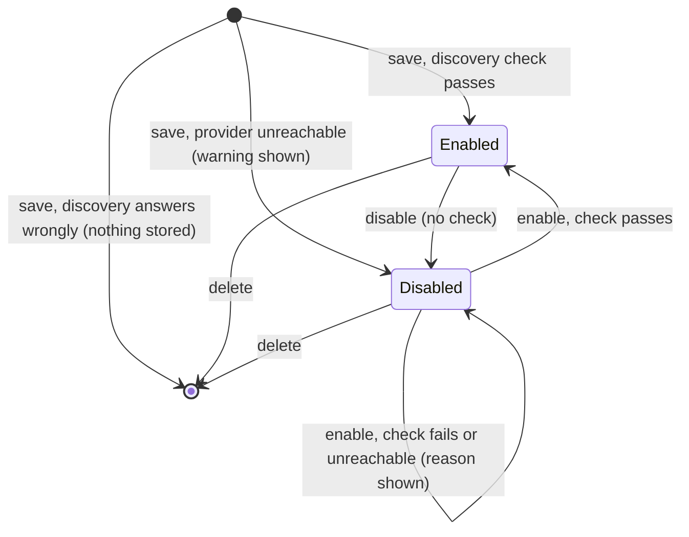

# Data Model: Generic OpenID Connect Connector

**Feature**: `002-generic-oidc-connector` | **Date**: 2026-10-10

Changes only. Everything not listed here is as in
[spec 001's data model](../001-umbral-mvp/data-model.md).

## `connectors` *(extended)*

| Column | Type | Change | Notes |
| --- | --- | --- | --- |
| `slug` | TEXT PK | rule extended | Built-in kinds: equals the kind, as before. `oidc`: chosen by the operator, `^[a-z0-9](?:[a-z0-9-]{0,30}[a-z0-9])?$`, 2–32 chars, not `discord`/`github`/`google`/`fake`/`oidc`. Immutable. |
| `kind` | TEXT NOT NULL | value added | `discord` \| `github` \| `google` \| `fake` \| **`oidc`**. |
| `issuer_url` | TEXT NULL | **new** | Required for `oidc`, NULL for every other kind. Absolute https URL, no query, no fragment, stored normalised (one trailing slash removed, host lowercased). **Immutable.** `UNIQUE` where not NULL (`ux_connectors_issuer`). |

All other columns (`display_name`, `client_id`, `client_secret_ref`,
`client_secret_hint`, `extra_scopes`, `is_enabled`, timestamps) apply to `oidc`
unchanged. `client_secret_ref` is required for `oidc` (Clarification Q3).

**State transitions for an `oidc` connector**



A configuration-file apply writes the row with the file's `enabled` value and
performs no check (FR-021).

## `linked_accounts` *(encoding extended)*

No column change. For `provider_kind = 'oidc'`:

| Column | Value |
| --- | --- |
| `provider_kind` | `oidc` |
| `provider_subject` | `<normalised issuer>#<sub>`, e.g. `https://auth.example.com/application/o/umbral#7f3c…` |

`#` cannot appear in an issuer (OIDC Discovery §3), so splitting at the first
`#` recovers both parts. The primary key `(provider_kind, provider_subject)`
therefore keeps two issuers' identical `sub` values apart (FR-016), and does not
mention the slug, so a deleted-and-re-added connector with the same issuer maps
people to the same row (FR-017).

**The immutable identifier per provider** (adds a row to 001's table):

| Provider | Field | Type in JSON | Trap |
| --- | --- | --- | --- |
| OIDC (any) | `sub` of the validated `id_token`, prefixed by issuer | string | Unique only within its issuer; never key on `sub` alone. Never on `preferred_username` or `email`, which are mutable. |

**Display**: the Users screen shows an `oidc` linked account as the display name
of the connector whose `issuer_url` matches, or the issuer's host when none
does (the connector was deleted).

## `settings` *(row semantics extended)*

| Key | Change |
| --- | --- |
| `schema_version` | Now read at startup. `1` → upgraded to `2` in place (adds `issuer_url` and its index). Higher than the build's version → startup refused with both versions named. |

## Provider self-description *(not stored)*

Read from `{issuer}/.well-known/openid-configuration` and the `jwks_uri` it
names; cached in memory per issuer (refresh ≥ 5 min apart, automatic every
12 h). Fields Umbral uses: `issuer`, `authorization_endpoint`,
`token_endpoint`, `userinfo_endpoint`, `jwks_uri`, `response_types_supported`,
`code_challenge_methods_supported`, `token_endpoint_auth_methods_supported`,
`id_token_signing_alg_values_supported`. Validation rules: research R2.

## Configuration file *(entry extended)*

```yaml
connectors:
  - slug: home
    kind: oidc
    issuer: https://auth.example.com/application/o/umbral
    display_name: Home
    client_id: umbral
    client_secret: ${UMBRAL_HOME_SECRET}
    enabled: true
    extra_scopes: []
```

Validation (whole document, before anything is written): `issuer` required for
`oidc`, forbidden otherwise; absolute https (localhost exception per research
R2); slug rule above; no duplicate issuer; `client_secret` an environment
reference, as for every connector.

## Security events

No new event type. `connector_created/updated/enabled/disabled/deleted` and
`sign_in_succeeded/failed` cover `oidc` connectors; `detail` carries causes such
as `discovery_unreachable`, `issuer_mismatch`, `id_token_invalid: <reason>`,
`userinfo_subject_mismatch` — never a token, code or secret.
