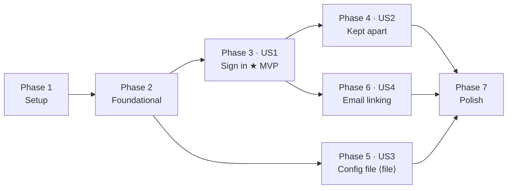

---

description: "Task list for the generic OpenID Connect connector"
---

# Tasks: Generic OpenID Connect Connector

**Input**: Design documents from `/specs/002-generic-oidc-connector/`

**Prerequisites**: [plan.md](./plan.md), [spec.md](./spec.md), [research.md](./research.md), [data-model.md](./data-model.md), [contracts/oidc-connector.md](./contracts/oidc-connector.md), [quickstart.md](./quickstart.md)

**Tests**: Included. The constitution's testing discipline makes them mandatory: every protocol behaviour needs a test against the real endpoint, every connector must be testable without real provider credentials, and a bug fix adds the test that would have caught it.

**Organization**: Grouped by user story so each can be built and tested on its own.

> **Pending decision — read before Phase 5.** Spec 004 (`integration/all-sessions`,
> "Remove the configuration document") removes the YAML file, and its
> clarification says 002 drops User Story 3, FR-019, FR-020, FR-022, SC-007 and
> connector extra scopes (CodeAlta task `tnch`). Until the owner confirms, those
> parts are kept here but **isolated**: Phase 5 (US3) and the tasks tagged
> **⟨file⟩** or **⟨scopes⟩**. If 004 is confirmed, skip them and record in
> spec.md that 004 supersedes them; nothing else depends on them.
>
> **Built on spec 003.** Spec 003 (per-app connectors) was merged into this
> branch before implementation (`6484e86`; plan "Built on spec 003", research
> R12). Read `specs/003-per-app-connectors/` first. 003 already provides the
> slug rule, the add route `POST /admin/connectors`, editable display names,
> `is_shared`, per-app choices and schema version 2 — the tasks below extend
> them. This feature's schema step is **version 3**.

## Format: `[ID] [P?] [Story] Description`

- **[P]**: can run in parallel (different files, no dependency on an incomplete task)
- **[Story]**: US1–US4 from spec.md
- Paths are relative to the repository root. F# compile order is the dependency
  graph: every new `.fs` file needs a `<Compile Include>` in the right place in
  its `.fsproj`, and every new handler's `endpoint` must be added to
  `Program.endpoints` (MetaTests enforces it).
- Run tests with `dotnet test Umbral.slnx` (Microsoft.Testing.Platform:
  `--filter-class "*Name*"`, not `--filter`).

---

## Phase 1: Setup

**Purpose**: the one new dependency and the test seam everything else uses.

- [x] T001 Add `Microsoft.IdentityModel.Protocols.OpenIdConnect` 8.19.2 (match the transitive `Microsoft.IdentityModel.*` version reported by `dotnet list src/Umbral/Umbral.fsproj package --include-transitive`) to src/Umbral/Umbral.fsproj, with a comment saying it is the discovery/JWKS client for the `oidc` connector (research R2)
- [x] T002 Add the provider-HTTP seam: a `ProviderAdapters.PrimaryHandler` factory type in src/Umbral/Infrastructure/ProviderAdapters.fs and register it in src/Umbral/Program.fs with `TryAddSingleton`, defaulting to `HttpClientHandler(AllowAutoRedirect = false)`, and have the named provider client's `ConfigurePrimaryHttpMessageHandler` use it (research R9; production behaviour byte-identical)
- [x] T003 [P] Create the stub identity provider in tests/Umbral.Tests/Infrastructure/StubOidcProvider.fs: an RSA key (plus a second "attacker" key), its JWKS, a discovery document with overridable fields, a token endpoint minting `id_token`s with Microsoft.IdentityModel (claims, `alg`, key, `iss`, `aud`, `exp`, `nonce` all overridable per test), a userinfo endpoint, and an "unreachable" mode; exposed as an `HttpMessageHandler`; add it to tests/Umbral.Tests/Umbral.Tests.fsproj after Infrastructure/Journeys.fs
- [x] T004 [P] Add a fixture variant in tests/Umbral.Tests/Infrastructure/Fixtures.fs that registers a given `HttpMessageHandler` through the T002 seam before `configureServices` runs

---

## Phase 2: Foundational (blocks every story)

**Purpose**: the kind, the column, the discovery cache and the adapter seam.

- [x] T005 Schema: add `issuer_url TEXT NULL` to the `connectors` CREATE TABLE and the `ux_connectors_issuer` unique partial index in src/Umbral/Infrastructure/Database.fs; bump `SchemaVersion` to 3; turn spec 003's inline 1→2 upgrade in `initializeSchema` into the first entry of an ordered list of steps applied inside its transaction (step 3: `ALTER TABLE connectors ADD COLUMN issuer_url TEXT NULL` + the index), stamp the new version, and refuse to start when the stored version is higher than the build's, naming both and saying to run the newer image or restore a backup (research R8; also closes CodeAlta task `pjkc` if it is still open — run `alta task start/complete` for it)
- [x] T006 [P] Tests in tests/Umbral.Tests/DatabaseTests.fs: a data directory built with the previous schema (one connector, one user, one linked account) upgrades in place with rows intact and accepts an `oidc` row; a fresh database is stamped with the new version directly; a database stamped one higher refuses to start with both versions in the message
- [x] T007 Domain in src/Umbral/Domains/Connectors.fs: add `Oidc` to `ProviderKind` (`"oidc"`, display "OpenID Connect"), `parseKind`, a static `endpointsFor Oidc` with scopes `openid email profile`, `UsesNonce = true`, `SupportsPkce = true` and empty URLs (with a comment that `Resolve` supplies them), `IssuerUrl: string option` on `Connector`; keep `allKinds` as the three built-in kinds
- [x] T008 Domain rules in src/Umbral/Domains/Connectors.fs: slugs keep spec 003's rule (`Ids.isValidSlug` + "not another kind's name", already in `Handlers/Admin/Connectors.fs`'s `create`) — adding `Oidc` to `parseKind` makes `oidc` reserved for other kinds automatically; add `normaliseIssuer allowLocalhostHttp` (absolute https, no query/fragment, one trailing slash dropped, host lowercased; `http://localhost|127.0.0.1|[::1]` only when the flag is set; guard against `System.Uri` turning a relative path into `file://`), and `oidcSubject issuer sub` / `parseOidcSubject` for `<issuer>#` (research R7); each error carries the operator text from the contract
- [x] T009 [P] Tests in tests/Umbral.Tests/OidcDomainTests.fs for T008: `oidc` is refused as the slug of a non-oidc connector, issuer normalisation table (trailing slash, uppercase host, query, fragment, relative path, http non-localhost, localhost with/without the flag), subject round trip and the `#` split
- [x] T010 ConnectorStore in src/Umbral/Infrastructure/ConnectorStore.fs: read/write `issuer_url` (literal SQL, `@parameters` only — MetaTests checks), add `findByIssuer`; map a unique-index violation on insert to a typed "issuer already configured" result
- [x] T011 Discovery cache: create src/Umbral/Infrastructure/OidcDiscovery.fs (compile after ProviderAdapters.fs) — a singleton holding one `ConfigurationManager<OpenIdConnectConfiguration>` per normalised issuer over an `HttpDocumentRetriever` built on the named provider client (`RequireHttps` per T008's localhost rule), and `check issuer : Task<DiscoveryResult>` returning `Ok config | Unreachable reason | Wrong reason` with every check from research R2 (issuer match slash-insensitive; authorization/token/jwks endpoints present and https; `code` in response types if listed; an asymmetric `id_token` alg if listed; basic or post in auth methods if listed); register it in src/Umbral/Program.fs
- [x] T012 [P] Tests in tests/Umbral.Tests/OidcDiscoveryTests.fs against the stub: OK; unreachable (connection failure, timeout, 500, HTML body) → `Unreachable`; issuer mismatch, missing token endpoint, http endpoint, HS256-only, no supported client auth → `Wrong` with the field named; trailing-slash variants accepted; a second `check` hits the cache (stub counts requests)
- [x] T013 Adapter seam in src/Umbral/Infrastructure/ProviderAdapters.fs: add `Resolve: Connector -> Task<Result<ProviderEndpoints, ConnectorError>>` to `IProviderAdapter`, add `Endpoints: ProviderEndpoints` to `AuthorizeRequest`, and make `commonAuthorizeParameters` read `request.Endpoints` (research R3)
- [x] T014 Built-in adapters return their static endpoints from `Resolve` in src/Umbral/Infrastructure/Providers/Discord.fs, GitHub.fs, Google.fs and Fake.fs (`Task.FromResult(Ok(endpointsFor kind))`); update the request construction in tests/Umbral.Tests/ProviderAdapterTests.fs so the golden URL assertions stay byte-identical
- [x] T015 src/Umbral/Handlers/Connect/Start.fs: call `adapter.Resolve connector` before `BuildAuthorizeUrl` and put the result in the request; an `Error` shows the existing end-user failure notice and records `sign_in_failed` with `error.Detail`

**Checkpoint**: full suite green with no behaviour change for Discord, GitHub, Google or Fake.

---

## Phase 3: User Story 1 — Sign in through my own identity provider (P1) 🎯 MVP

**Goal**: an operator adds a provider by issuer from the admin UI and people sign in through it.

**Independent test**: against the stub provider, add it through the Connectors screen only, register an app, complete a sign-in; the app receives Umbral tokens with `idp = oidc` (the kind, per spec 003).

### Tests for User Story 1

- [x] T016 [P] [US1] Adapter tests in tests/Umbral.Tests/OidcAdapterTests.fs: authorize URL golden test (scopes, `S256` challenge, `nonce`, `state`, exact `redirect_uri`); PKCE omitted when the document lists only `plain`; token request uses `client_secret_basic` by default and `client_secret_post` when basic is not listed; a valid login yields subject `<issuer>#`, email, name (falls back to `preferred_username`), picture
- [x] T017 [P] [US1] Refusal tests in tests/Umbral.Tests/OidcAdapterTests.fs, one per row of the contract's "Accepted identity" table, each asserting the recorded reason: no `id_token`; signed by the attacker key; `alg: none`; HS256; wrong `iss`; wrong `aud`; multi-`aud` without matching `azp`; expired beyond 2 min skew (driven by the fake `TimeProvider`); nonce mismatch; userinfo `sub` differs
- [x] T018 [P] [US1] Key-rotation test in tests/Umbral.Tests/OidcAdapterTests.fs: the stub switches signing key with a new `kid`; the next login succeeds after one cache refresh (FR-013)
- [x] T019 [P] [US1] End-to-end tests in tests/Umbral.Tests/OidcConnectorTests.fs (TestServer + stub via T004): operator adds `home` (kind `oidc`) through spec 003's `POST /admin/connectors`; the callback URL is shown; the picker lists "Home" for an app set to all shared connectors, and only for a limited app whose set contains it (spec 003); a full authorization-code login reaches the app with `idp = oidc` (the kind, per spec 003 — not the slug); a second login keeps the same `sub` and one user; form errors for `oidc` (bad slug, another kind's name, duplicate slug, http issuer, relative issuer, issuer mismatch, missing secret) re-render the add form with input kept and the contract's message; no token, code or secret in any captured log line (reuse the LogRedactionTests capture)

### Implementation for User Story 1

- [x] T020 [US1] Create the adapter src/Umbral/Infrastructure/Providers/Oidc.fs (compile after OidcDiscovery.fs): `Kind = Oidc`; `Resolve` via `OidcDiscovery.check` (Unreachable/Wrong → `ProviderUnreachable`/`MalformedResponse` with a reason that never contains a token); `BuildAuthorizeUrl` per the contract; `ExchangeAndFetch` with bounded read and 10 s timeout, client auth per research R5, `JsonWebTokenHandler.ValidateTokenAsync` with `ValidIssuer` (both slash forms), `ValidAudience`, JWKS keys, asymmetric `ValidAlgorithms`, 2 min skew and lifetime against Umbral's `TimeProvider`, then nonce and `azp` checks, one `RequestRefresh` + retry on an unknown `kid`, userinfo fallback with subject check, `email_verified` only from the JSON literal `true` (research R4–R7); register it in src/Umbral/Program.fs with the other adapters
- [x] T021 [US1] Texts in src/Umbral/Views/Texts.fs: section heading, Add form labels and hints, the FR-009 email-trust warning, the FR-004 immutability sentence, every message in the contract's Add-form and discovery-outcome tables (each naming the next action, spec 001 SC-010)
- [x] T022 [US1] Connectors screen in src/Umbral/Handlers/Admin/Connectors.fs (spec 003's layout): an `oidc` connector renders as a card like any other, plus its issuer read-only with the immutability sentence; the `oidc` kind has no empty card; spec 003's add form offers "OpenID Connect provider" as a kind, with an issuer field (hint: only for OpenID Connect) and the email-trust warning; works without htmx
- [x] T023 [US1] Extend spec 003's `create` handler (`POST /admin/connectors`) in src/Umbral/Handlers/Admin/Connectors.fs for `kind = oidc`: require and normalise `issuer` (T008), run `OidcDiscovery.check`, on Ok save enabled with `issuer_url`, on Wrong re-render the add form with the input kept and the reason (spec FR-005), store the secret through `ISecretStore`, emit `connector_created`; other kinds keep 003's behaviour
- [x] T024 [US1] The update route in src/Umbral/Handlers/Admin/Connectors.fs (`POST /admin/connectors/{slug}`) accepts an `oidc` slug: display name, client ID, secret replacement; ignores any posted slug or issuer
- [ ] T025 [US1] ⟨scopes⟩ Extra scopes field on the Add form and the update route for `oidc` connectors in src/Umbral/Handlers/Admin/Connectors.fs — **skip if spec 004 is confirmed** (it removes extra scopes for every kind)
- [x] T026 [US1] Picker in src/Umbral/Handlers/Connect/Picker.fs: confirm spec 003's filtering (shared / per-app set) includes `oidc` connectors under their display name with no kind-specific code; add the kind's button styling if the picker styles by kind

**Checkpoint**: User Story 1 works end to end; this is the MVP.

---

## Phase 4: User Story 2 — Several providers, kept apart (P2)

**Goal**: identity is (issuer, subject); providers are managed independently; unreachable-at-save is stored disabled and enabling re-checks.

**Independent test**: two stub providers with different issuers both return `sub = "1"` → two users; delete one and re-add it with the same issuer under a new slug → same `sub` as before.

### Tests for User Story 2

- [ ] T027 [P] [US2] In tests/Umbral.Tests/OidcConnectorTests.fs: two issuers with the same `sub` produce two users; delete + re-add with the same issuer under another slug keeps the user id and `sub`; a second connector with an already-configured issuer is refused with a message; toggling or replacing the secret of one provider leaves the other untouched and needs no restart
- [ ] T028 [P] [US2] In tests/Umbral.Tests/OidcConnectorTests.fs: provider unreachable at save → saved disabled with the warning, absent from the picker; enabling while still unreachable → refused with the reason; stub back up → enabling succeeds and a login works (Clarification Q2); disabling never contacts the provider

### Implementation for User Story 2

- [ ] T029 [US2] In the `oidc` branch of `create` in src/Umbral/Handlers/Admin/Connectors.fs, `Unreachable` saves the connector with `is_enabled = 0` and redirects with the contract's warning notice; a duplicate issuer (T010's typed result) re-renders with its message
- [ ] T030 [US2] In src/Umbral/Handlers/Admin/ConnectorToggle.fs, enabling an `oidc` connector runs `OidcDiscovery.check` first and refuses with the reason on `Unreachable` or `Wrong`; built-in kinds unchanged
- [ ] T031 [US2] In src/Umbral/Infrastructure/UserStore.fs and the Users screen (src/Umbral/Handlers/Admin/Users.fs), show an `oidc` linked account as the display name of the connector with that issuer, else the issuer's host (data-model "Display")
- [ ] T032 [US2] Confirm src/Umbral/Handlers/Admin/ConnectorDelete.fs needs no change for `oidc` (users and linked accounts survive) and add the FR-017 sentence to the delete confirmation text in src/Umbral/Views/Texts.fs if it helps the operator ("people will reconnect if you add this issuer again")

**Checkpoint**: Stories 1 and 2 pass independently.

---

## Phase 5: User Story 3 — The same provider, from the configuration file (P2) ⟨file⟩

> **Skip this whole phase if spec 004 is confirmed** (see the note at the top).

**Goal**: `kind: oidc` entries in the YAML file, validated, applied idempotently without contacting the provider, exported back.

**Independent test**: a clean instance started from a file declaring one `oidc` provider signs in through it; export round-trips.

### Tests for User Story 3

- [ ] T033 [P] [US3] ⟨file⟩ In tests/Umbral.Tests/ConfigFileTests.fs: apply twice → one connector, no `connector_updated` on the second; `issuer` missing on `oidc` and present on `github` each fail naming the entry; bad slug fails; two entries with one issuer fail; changing the issuer of an existing slug fails at startup; nothing partly applied; startup succeeds with the provider unreachable; export → import round-trips the entry

### Implementation for User Story 3

- [ ] T034 [US3] ⟨file⟩ src/Umbral/Domains/ConfigDocument.fs: `issuer` on connector entries with the contract's validation, reusing T008
- [ ] T035 [US3] ⟨file⟩ src/Umbral/Infrastructure/ConfigFile.fs: apply writes `issuer_url`, refuses an issuer change on an existing slug, never calls `OidcDiscovery`
- [ ] T036 [US3] ⟨file⟩ src/Umbral/Handlers/Admin/ConfigExport.fs: emit `issuer:` for `oidc` connectors

**Checkpoint**: file parity holds for `oidc`.

---

## Phase 6: User Story 4 — Linking by email, with the operator warned (P3)

**Goal**: spec 001's linking rule holds for `oidc`; the warning is shown.

**Independent test**: a user created through GitHub with a verified email is joined by an `oidc` sign-in asserting the same email as JSON `true`; the string `"true"` creates a separate user.

### Tests for User Story 4

- [ ] T037 [P] [US4] In tests/Umbral.Tests/OidcConnectorTests.fs: verified email (`true`) links to the existing user (one user, two linked accounts); `"true"`, `false` and absent each create a separate user; the Add form contains the FR-009 warning text

### Implementation for User Story 4

- [ ] T038 [US4] Verify no code change is needed in src/Umbral/Infrastructure/Users.fs / src/Umbral/Domains/Linking.fs beyond the adapter's `EmailVerified` mapping (T020); if the linking path special-cases provider kinds, extend it for `oidc` and say so in the commit

**Checkpoint**: all stories pass.

---

## Phase 7: Polish & cross-cutting

- [ ] T039 [P] Write docs/connectors/oidc.md in the voice of the three existing walkthroughs (FR-024): where to find the issuer in Authentik, Keycloak, Pocket ID and Authelia, and in general; the callback URL `<origin>/connect/<slug>/callback`; choose a **confidential** client and `client_secret_basic` or `client_secret_post`; scopes `openid email profile`; the email-trust warning; putting a plain-http provider behind the reverse proxy that fronts Umbral; switching an HS256-only provider to RS256/ES256; troubleshooting (issuer mismatch, "saved but disabled", expired tokens from clock skew, signature failures)
- [ ] T040 [P] README.md: add OpenID Connect providers to the intro sentence, the provider list and the walkthrough links; and the "Other providers" line in docs/connectors/discord.md, github.md and google.md
- [ ] T041 [P] specs/001-umbral-mvp/data-model.md: a pointer under `connectors` and `linked_accounts` to this feature's data model (issuer_url, the `oidc` subject encoding)
- [ ] T042 Run the full suite (`dotnet test Umbral.slnx`) and confirm MetaTests (new endpoint listed, no interpolated SQL), CsrfTests (new POST covered), SecurityEventCoverageTests and LogRedactionTests are green
- [ ] T043 Build the container (`docker build -t umbral-oidc .`), run it with the stub replaced by a real provider if one is available, and walk quickstart scenarios 1 and 4; record the measured time for scenario 1 against SC-001. If no real provider is available, record that SC-001/SC-002 remain to be measured (as spec 001's T104)

---

## Dependencies & execution order

- **Setup → Foundational → US1** is strict: US1 needs the kind, the column, the cache and the seam.
- **US2 and US4 need US1** (they sign in through it). They are independent of each other.
- **US3 needs only Foundational** (domain rules and the column) and can run in parallel with US1 — or be skipped entirely if spec 004 is confirmed.
- Within a story: tests first, written to fail, then implementation.

## Parallel opportunities

| Phase | Run together |
| --- | --- |
| 1 | T003, T004 (after T002) |
| 2 | T006, T009, T012 once their subjects exist; T010 alongside T011 |
| 3 | T016, T017, T018, T019 (all test files) before T020–T026 |
| 4 | T027, T028 |
| 7 | T039, T040, T041 |

## Implementation strategy

1. **MVP = Phases 1–3** (T001–T026): an operator can add any OIDC provider and
   people sign in through it, with signature-validated identities. Stop and
   demo here.
2. **Phase 4** makes identity safe across several providers and handles the
   unreachable-at-save case — required before release, since a single-provider
   demo hides the (iss, sub) bug class.
3. **Phase 6** is mostly verification of spec 001's rule.
4. **Phase 5** only if spec 004 is not confirmed.
5. **Phase 7** before merging: docs are part of done (constitution VI).

Delegate per story: each phase's tests and implementation touch a small,
mostly disjoint set of files (Phase 3: Providers/Oidc.fs + Connectors.fs;
Phase 4: ConnectorToggle/UserStore; Phase 5: config files), but they share
Texts.fs and OidcConnectorTests.fs, so run writing agents one at a time or in
separate worktrees.

## Task count

| Phase | Tasks |
| --- | --- |
| 1 Setup | 4 |
| 2 Foundational | 11 |
| 3 US1 — Sign in (MVP) | 11 (one ⟨scopes⟩) |
| 4 US2 — Kept apart | 6 |
| 5 US3 — Config file ⟨file⟩ | 4 |
| 6 US4 — Email linking | 2 |
| 7 Polish | 5 |
| **Total** | **43** (38 if spec 004 is confirmed) |
