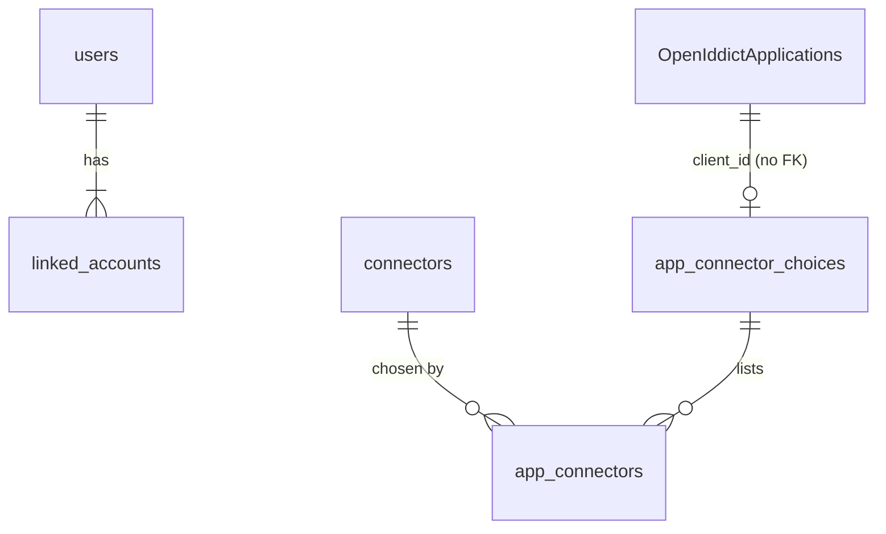
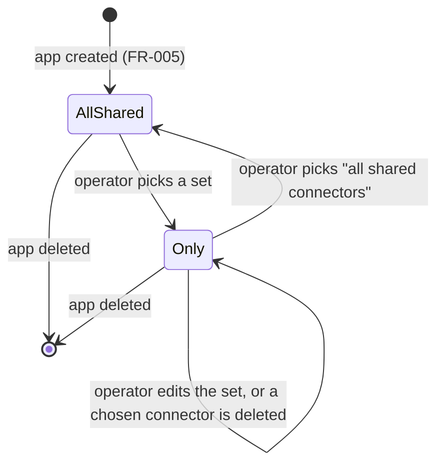

# Data Model: Federated Login for Every App, with Optional Per-App Connectors

**Feature**: `003-per-app-connectors` | **Date**: 2026-10-10

This feature changes the model of
[001's data model](../001-umbral-mvp/data-model.md) in four places: one new
column on `connectors`, two new tables for an app's connector choice, one new
claim in the Umbral session cookie, and two optional keys in the configuration
document. `users`, `linked_accounts`, `settings` (beyond `schema_version`),
`security_events` and OpenIddict's lane are unchanged. No new top-level concept
appears (FR-021): "shared" is a property of a Connector, and the connector
choice is a property of an App.

The two lanes still never join. An app is an `OpenIddictApplication` row that
Umbral does not own, so the new tables refer to it by `client_id` as a plain
string, with no foreign key into OpenIddict's tables.



---

## `connectors` (changed)

One new column. Everything else is as in 001.

| Column | Type | Notes |
| --- | --- | --- |
| `slug` | TEXT PK | Unchanged in shape. Now chosen by the operator for any connector after the first of a kind (FR-012). Still immutable, because it is in `/connect/{slug}/callback` (FR-013). |
| `kind` | TEXT NOT NULL | Unchanged. No longer unique in practice: several rows may share a kind. Nothing in the schema ever made it unique; only the Connectors screen did. |
| `display_name` | TEXT NOT NULL | Unchanged. Now the way the operator tells two buttons of the same kind apart on one sign-in page, so the card form exposes it. |
| `is_shared` | INTEGER NOT NULL DEFAULT 1 | **New.** 0/1. A shared connector is offered to every app set to "all shared connectors". A connector that is not shared is offered only to apps whose chosen set contains it (FR-014). |

**Rules**

- A slug must pass `Ids.isValidSlug` (lower-case letters, digits and hyphens,
  up to 32 characters) and must not already exist. It is set at creation and
  never updated (FR-013).
- The first connector of a kind defaults its slug to the kind's name, so the
  callback addresses already registered at the providers keep working (FR-013).
  The empty card for a kind with no connector still posts to
  `/admin/connectors/{kind}` with that default, which keeps the five-minute path
  free of an "add" step (SC-006).
- The kind of an existing connector is read from its row, never inferred from
  its slug. `discord-frunchy` is a `discord` connector because its row says so.
- New connectors default to shared (FR-014).
- Deleting a connector cascades to `app_connectors` (FR-011). It still does not
  touch `linked_accounts`, users or sessions, as in 001.

---

## `app_connector_choices` (new)

A marker: one row per app that is limited to a chosen set. An app with no row
here is set to "all shared connectors".

| Column | Type | Notes |
| --- | --- | --- |
| `client_id` | TEXT PK | The OpenIddict application's client id. Not an FK: OpenIddict's tables belong to its EF migrations. |

The marker row is separate from the set so that an app stays limited when its
set becomes empty (FR-011). Without it, deleting an app's last chosen connector
would make the app indistinguishable from one set to "all shared connectors",
and it would silently widen.

---

## `app_connectors` (new)

The chosen set of a limited app.

| Column | Type | Notes |
| --- | --- | --- |
| `client_id` | TEXT NOT NULL | FK → `app_connector_choices.client_id` ON DELETE CASCADE. |
| `connector_slug` | TEXT NOT NULL | FK → `connectors.slug` ON DELETE CASCADE. |

Indexes: `PRIMARY KEY (client_id, connector_slug)`;
`INDEX(connector_slug)`, which is the lookup the FR-010 warning performs when a
connector is about to be disabled or deleted.

**Rules**

- A row may name a connector that is disabled. It stays in the set and is simply
  not offered until it is enabled again (FR-007).
- A row may name a connector that is shared or not shared. Membership in the set
  is what counts for a limited app; the shared setting only matters to apps set
  to "all shared connectors".
- Deleting a connector removes its rows through the cascade and leaves the
  marker row, so the app stays limited (FR-011).
- Deleting an app removes its marker row in the same handler, which cascades to
  its set. This is done by `AppDelete` itself, because no foreign key can point
  into `OpenIddictApplications`.
- Switching an app back to "all shared connectors" deletes its marker row, and
  its set with it.

---

## The connector choice

The two tables are read into one value, `AppChoice`, in `Domains/Connectors.fs`:

| Value | Stored as | Offers |
| --- | --- | --- |
| `AllShared` | no row in `app_connector_choices` | every enabled connector with `is_shared = 1` (FR-006) |
| `Only of Set<string>` | a marker row and zero or more `app_connectors` rows | exactly the enabled connectors whose slug is in the set (FR-007) |

`offeredTo choice connectors` is the only place this rule is written. The
sign-in page, the authorize endpoint's session check (FR-008), the admin
warnings (FR-010) and the Apps screen all call it, so they cannot disagree.
`strandedApps` applies it to every app against the connectors as they would be
after a change, and returns the apps left offering nothing. That is what the
FR-010 warning names. The 001 guard counted enabled connectors across the whole
instance and could not see a limited app being stranded.

A connector choice only decides how people sign in to an app. It never decides
which users may (FR-020): any enabled user may sign in to any app through a
connector it offers.

### State transitions



There is no transition from `Only` to `AllShared` except by the operator's
hand. An `Only` with an empty set, or with no enabled member, is a valid state:
the app's sign-in page says no sign-in method is available. The operator is
warned, naming the app, before any change that leads there (FR-010), whether
the change is disabling or deleting a connector, marking it not shared, or
editing the app's set.

---

## The Umbral session (changed meaning)

The session cookie is not a table, but what it carries changes.

| Claim | Holds | Notes |
| --- | --- | --- |
| `NameIdentifier` | `users.id` | Unchanged. |
| `idp` | the provider **kind**, e.g. `discord` | Changed from the slug. Apps receive this value, and the README promises the kind. With two Discord connectors, sending the slug would give an app a new value for the same person. |
| `connector` | the connector **slug**, e.g. `discord-frunchy` | **New.** The connector that established the session, which FR-008 checks. Not passed on to apps. |

**Rules**

- When an app sends someone to `/connect/authorize`, Umbral honours an existing
  session only if its connector is in `offeredTo` for that app. Otherwise it
  shows that app's sign-in page (FR-008). The check runs before OpenIddict signs
  anything.
- A session from before the upgrade has no `connector` claim. Its `idp` holds the
  slug, and every slug that could exist then equalled its kind, so that one value
  serves as both the connector and the kind.
- A session established through a connector that has since been disabled,
  deleted or removed from the app's set fails the check and leads to the sign-in
  page. The person is not signed out of Umbral.

---

## Identity across connectors of one kind

`linked_accounts` is unchanged, and that is the point. It is keyed on
`(provider_kind, provider_subject)`, not on the connector, so a person who signs
in to one app through `discord` and to another through `discord-frunchy` with
the same Discord account finds the same row, the same user and the same `sub`
(FR-015, SC-004). The linking rule of 001 runs unchanged.

This rests on Discord, GitHub and Google giving a person the same account
identifier whichever of the operator's upstream applications they sign in
through. A provider that issues a per-application identifier would break it;
the generic OpenID Connect connector of feature 002 has to settle that case
there.

---

## `settings`

`schema_version` moves from `1` to `2`. No other key changes.

---

## Upgrading from schema version 1

`initializeSchema` runs in one transaction, as today:

1. The `CREATE TABLE IF NOT EXISTS` script creates `app_connector_choices` and
   `app_connectors` on a database that lacks them.
2. When the stored `schema_version` is `1`, it runs
   `ALTER TABLE connectors ADD COLUMN is_shared INTEGER NOT NULL DEFAULT 1` and
   sets the stored version to `2`. SQLite has no `ADD COLUMN IF NOT EXISTS`, so
   the stored version is what decides whether the column is added.
3. A fresh database gets the column from the `CREATE TABLE` script and has
   version `2` written directly.

No data is rewritten. The column default makes every existing connector shared,
and the empty choice tables leave every existing app on "all shared
connectors", so every app offers exactly what it offered before (FR-019,
SC-003). A stored version higher than `2` still fails loudly, as in 001.

---

## The configuration document

Two optional keys and nothing else, because the document is due to be removed
in a later feature. Its round-trip promise stands until then (FR-016, FR-017).

```yaml
version: 1

connectors:
  - slug: discord
    kind: discord
    display_name: Discord
    client_id: "1234567890"
    client_secret: ${UMBRAL_DISCORD_SECRET}
  - slug: discord-frunchy
    kind: discord
    display_name: Discord (Frunchy)
    client_id: "2345678901"
    client_secret: ${UMBRAL_DISCORD_FRUNCHY_SECRET}
    shared: false

apps:
  - client_id: frunchy
    name: Frunchy
    client_secret: ${UMBRAL_FRUNCHY_SECRET}
    redirect_uris:
      - https://frunchy.example.com/signin-oidc
    connectors: [discord-frunchy]
```

| Key | On | Absent means | Notes |
| --- | --- | --- | --- |
| `shared` | a connector entry | `true` | Maps to `is_shared`. |
| `connectors` | an app entry | "all shared connectors" | A list of slugs. Present but empty (`[]`) means limited to nothing, which is distinct from absent and round-trips as such. |

**Rules**

- An app's `connectors` list that names a slug the same document does not define
  refuses the whole document, naming the app entry and the slug (FR-018). The
  check sees only the document, never the database, so whether a file is valid
  does not depend on the instance it is applied to.
- A slug listed twice in one app's `connectors` is refused, as duplicate slugs
  and client ids already are.
- Export writes `shared: false` only for connectors that are not shared, and
  `connectors` only for limited apps, including `[]` for a limited app with an
  empty set. Applying the export to a fresh instance reproduces every choice and
  every shared setting (FR-017, SC-005).
- `version` stays `1`: both keys are optional, so every existing document means
  what it meant before.
