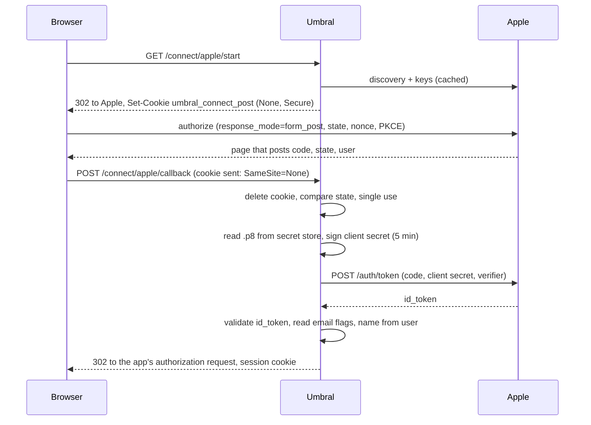

# Implementation Plan: Sign in with Apple

**Spec**: [apple-connector.spec.md](apple-connector.spec.md) · **Research**: [research.md](research.md) · **Data model**: [data-model.md](data-model.md) · **Contract**: [contracts/routes-and-screens.md](contracts/routes-and-screens.md)

## Summary

A built-in connector kind `apple`, one per instance. Its adapter is the OIDC
adapter's functions with a fixed issuer and three differences: the client secret
is a five-minute ES256 JWT Umbral signs per token request from the `.p8` key in
the secret store; the answer is a form post, so the round trip gets a second
correlation cookie (`SameSite=None; Secure`) and the callback a POST route; and
the name comes from the post's `user` field. The Connectors screen gets a pane
with four values, the sign-in page a button that follows Apple's rules.

## Technical Context

F# on .NET 10, Oxpecker, SQLite, `Microsoft.IdentityModel.*` 8.19.2 (already
referenced), xUnit with the in-process test server and a stub provider behind
`ProviderAdapters.PrimaryHandler`. No new dependency.

## Constitution Check

- **I. Three concepts**: a Connector kind; no new noun.
- **II. One artifact**: nothing new to run; one ES256 signature per sign-in and
  one more cached discovery document. No package added.
- **III. Standards**: the JWT is signed and the `id_token` validated by
  Microsoft.IdentityModel; discovery and keys by its `ConfigurationManager`.
  Umbral compares strings (`state`, `nonce`) and parses two booleans.
- **IV. Secure by default**: `state` single use, PKCE sent, exact return URL,
  full `id_token` validation with asymmetric algorithms only, the key in the
  secret store and nowhere else, every refusal in the security log, the sign-in
  rate limit on the new POST. The one route without an antiforgery token has its
  reasoning in research R3.
- **VI. Documentation**: a walkthrough, the navigation lines, the README, the
  changelog file with its Upgrade note.
- **VII. Default answer is no**: one Apple connector; no notifications, no
  revocation, no second Services ID; the logo waits for the maintainer.

## How the pieces fit

## Files

Under `src/Umbral/`:

- `Domains/Connectors.fs`: `Apple` kind, `AppleKeyIds`, `Connector.AppleKey`,
  `ProviderEndpoints.AnswersByFormPost`, `appleIssuer`, `parseAppleId`,
  `parseServicesId`, `setupCaveat Apple`.
- `Infrastructure/Database.fs`: columns, `UpgradeToVersion10`, `SchemaVersion = 10`.
- `Infrastructure/ConnectorStore.fs`: read and write the two columns.
- `Infrastructure/OAuthRoundTrip.fs`: `ResponseMode` (`Redirect | FormPost`),
  the second cookie, `Answer` (the `state` and `error` the caller read from the
  query or the form) passed to `complete`.
- `Infrastructure/ProviderAdapters.fs`: `ExchangeRequest.PostedUser`.
- `Infrastructure/Providers/Oidc.fs`: `mapDiscovery`, `offersPkce`,
  `exchangeCode` and a new `validateIdToken` made public; `OidcAdapter` calls
  them. No change in behaviour.
- `Infrastructure/Providers/Apple.fs` (new, after `Oidc.fs`): `normaliseKey`,
  `clientSecret`, `claimIsTrue`, `nameOf`, `check` (the Enable check),
  `AppleAdapter`.
- `Handlers/Connect/Start.fs`: the response mode from the resolved endpoints.
- `Handlers/Connect/Callback.fs`: one handler body for both modes, the POST
  route, the form read with its cap, `user_cancelled_authorize`.
- `Handlers/Admin/AppleConnector.fs` (new, before `Connectors.fs`): the pane's
  Settings form and the form's parsing.
- `Handlers/Admin/Connectors.fs`: the Apple row, `saveApple`, its route, the
  notices; the add form refuses the kind.
- `Handlers/Admin/ConnectorToggle.fs`: the Enable check for Apple.
- `Handlers/Connect/Picker.fs`, `Views/Components.fs`: the Apple button.
- `Views/Texts.fs`: the words of the contract.
- `Assets/` (`build-css.sh` sources and the generated `umbral.css`):
  `.um-textarea`, `.um-btn-apple`.
- `Program.fs`, `Umbral.fsproj`: the adapter's registration, the two new files.

Tests (`tests/Umbral.Tests/`): `Infrastructure/FakeApple.fs` (new stub),
`AppleDomainTests.fs`, `AppleClientSecretTests.fs`, `AppleSignInTests.fs`,
`AppleAdminTests.fs` (new); additions to `OAuthRoundTripTests.fs`,
`DatabaseTests.fs`, `CsrfTests.fs` (comment), and every test that builds a
`Connector` or a `ProviderEndpoints` literal.

Docs: `docs/connectors/apple.md` (new), the "Other providers" line of the six
walkthroughs, `README.md`, `docs/native-apps.md`, `docs/run/backup.md` (schema
version), `site/sidebar.mjs`, `DESIGN.md` (one sentence),
`changelog.d/013-apple-connector.md`.

## Order

Foundation (kind, record, schema) first, because every later step compiles
against it. Then the round trip, then the adapter with the fake Apple and the
sign-in tests, then the admin pane, then the button. The docs can be written
beside any of them. One F# writer at a time (shared `obj/`).
