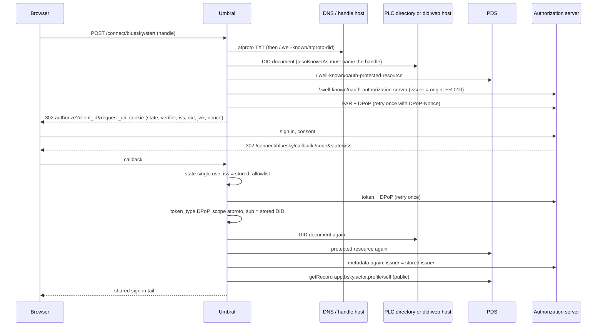

# Implementation Plan: The Bluesky connector

**Spec**: [bluesky-connector.spec.md](bluesky-connector.spec.md) · **Research**: [research.md](research.md) · **Data model**: [data-model.md](data-model.md) · **Contract**: [contracts/routes-and-screens.md](contracts/routes-and-screens.md) · **Design**: `design/contracts/bluesky-connector-ui.md` · **Feasibility**: `.alta/reviews/2026-11-11-bluesky/feasibility.md`

## Summary

A built-in connector kind `bluesky`, one per instance, shaped like Fediverse. A person types a handle on a step page. Umbral then:
1. resolves the handle to a DID (DNS TXT, then HTTPS) and checks it both ways;
2. reads the DID document, then the PDS, then its one authorization server;
3. checks the operator's server list;
4. pushes an authorization request with PKCE and a DPoP proof from a fresh ES256 key, and redirects.

On return, it checks `state` and `iss`, exchanges the code with DPoP (one nonce retry), checks the token answer, resolves the DID again to prove that authorization server speaks for it, reads the public profile, and signs the person in through the shared tail. The DPoP key lives only in the encrypted correlation cookie. Umbral serves its client metadata document as a public client.

## Technical Context

F# on .NET 10, Oxpecker, SQLite, xUnit with the in-process test server and stub upstreams behind `Providers.Fediverse.PrimaryHandler`. Two new packages:
- `Duende.IdentityModel.OidcClient.Extensions` 7.1.1, which brings in `Duende.IdentityModel.OidcClient` 7.1.1 and `Duende.IdentityModel` 8.1.0. All three are Apache-2.0. Its `System.IdentityModel.Tokens.Jwt [8.19.2, 9)` is already satisfied at 8.19.2.
- `DnsClient` 1.8.0 (Apache-2.0, no dependencies).

## Constitution Check

| Gate | Assessment |
|---|---|
| I. Three concepts | PASS. A Connector kind. A server, a DID or a handle is not a new concept for the operator. |
| II. One artifact | PASS, with a measurement. One column (schema 12), three plus one packages, loaded lazily (R12). The idle-memory test runs with the connector enabled. Nothing runs in the background. |
| III. Standards | PASS. The DPoP proofs come from Duende's factory (signed by `JsonWebTokenHandler`). Umbral is a public client: no assertion, no `id_token`, and the access token is never read. The rest is HTTP flow and string comparisons, as in `Fediverse.fs`. |
| IV. Secure by default | PASS. PAR, PKCE S256, single-use `state`, `iss` checked, the exact redirect, the DID re-resolved for authority, a handle checked both ways, the SSRF guard on every fetch, time and size limits, no redirects, the key never stored, rate limits, every failure in the security log. |
| VI. Documentation | PASS. A walkthrough, the navigation lines, the README, the sidebar, a changelog file, and the backup page's schema version. |
| VII. Default answer is no | PASS. Sign-in only. The server list decides who can be a user. No posting, no refresh tokens, no profile sync beyond sign-in. |

**Complexity Tracking.** Two dependencies are added. The simpler alternative, signing proofs with `JsonWebTokenHandler` as Apple's client secret does, was rejected: the task asks for a maintained DPoP implementation, and the factory is 1 package plus 2 small ones. HTTPS-only handle resolution, which needs no DnsClient, was rejected because DNS-only handles are the self-hosters' case.

## Flow

## Files

Under `src/Umbral/`:

- `Umbral.fsproj`: the two packages, each with a comment; the new files.
- `Domains/Connectors.fs`: `Bluesky` kind, with every `match` on the kind (`Value`, `DisplayName`, `parseKind`, `isBuiltIn` or its equivalent, `endpointsFor`, `setupCaveat`). The `FediverseAccess` comment names both kinds.
- `Domains/Bluesky.fs` (new, after `Domains/Fediverse.fs`): pure parsing and checks (data model).
- `Infrastructure/Database.fs`: `UpgradeToVersion12`, `SchemaVersion = 12`.
- `Infrastructure/ProviderAdapters.fs`: `ProviderProfile.Server`.
- `Infrastructure/UserStore.fs`: writes `provider_server`.
- `Infrastructure/OAuthRoundTrip.fs`: `Correlation.Extra`, an eighth field.
- `Infrastructure/Providers/Bluesky.fs` (new, after `Providers/Fediverse.fs`): `Options`, `TxtResolver`, `resolveHandle`, `resolveDid`, `discover`, `pushAuthorization`, `exchange`, `profile`, and the DPoP calls (R1).
- `Infrastructure/BlueskyAccounts.fs` (new, after `FediverseServers.fs`): `recheckServer`.
- `Infrastructure/ConnectorStore.fs`, `Infrastructure/EmailDomainRules.fs`: the kind wherever Fediverse is matched.
- `Handlers/Connect/Bluesky.fs` (new, after `Handlers/Connect/Fediverse.fs`): the step GET and POST, the callback, and the client metadata route.
- `Handlers/Connect/Authorize.fs`, `Handlers/Connect/Token.fs`: call `BlueskyAccounts.recheckServer` beside the Fediverse re-check.
- `Handlers/Admin/BlueskyConnector.fs` (new, after `FediverseConnector.fs`): the pane and its save.
- `Handlers/Admin/Connectors.fs`, `ConnectorToggle.fs`, `Apps.fs`: the list order, the pane dispatch, the Enable check, and "limited iff Only these servers".
- `Views/Texts.fs`: the words of the design note.
- `Program.fs`: the options, `TxtResolver`, the `umbral-bluesky` client on the guarded handler, and the endpoints.

Tests (`tests/Umbral.Tests/`):
- `Infrastructure/FakeAtproto.fs` (new): the DNS map, a PLC directory, `did:web` hosts, a PDS and an authorization server. It verifies each DPoP proof (signature against the header's `jwk`, `typ`, `htm`, `htu`, `nonce`, `jti` unused), issues nonces, and has modes for every refusal.
- `BlueskyDomainTests.fs`, `BlueskyClientTests.fs`, `BlueskySignInTests.fs`, `BlueskyAdminTests.fs` (new).
- Additions to `DatabaseTests.fs` and `OAuthRoundTripTests.fs`, and to the list-order tests of the Connectors screen.

Docs:
- `docs/connectors/bluesky.md` (new);
- the "Other providers" line of every walkthrough;
- `README.md`, `site/sidebar.mjs`, `docs/run/backup.md` (schema 12);
- `changelog.d/015-bluesky-connector.md`.

## Order

1. Packages, kind and profile field, so everything compiles.
2. The schema and the re-check.
3. The pure domain.
4. The correlation field.
5. The client.
6. The fake and the sign-in handlers with their tests.
7. The pane.
8. The docs, which can be written beside steps 6 and 7.

One F# writer at a time, because the children share `obj/`.
